# 日本株財務分析ツール — 完全アーキテクチャ図

> **閲覧方法**: VS Code に「Markdown Preview Mermaid Support」拡張をインストールし、`Ctrl+Shift+V` でプレビューを開くと図が表示されます。

---

## 目次

1. [全体構成図（コンポーネント図）](#1-全体構成図コンポーネント図)
2. [ユースケース図](#2-ユースケース図)
3. [データベース設計（ER図）](#3-データベース設計er図)
4. シーケンス図
   - [4-1. 財務データ収集フロー](#4-1-財務データ収集フロー)
   - [4-2. 株価履歴収集フロー](#4-2-株価履歴収集フロー)
   - [4-3. 認証フロー](#4-3-認証フロー)
   - [4-4. 業種別OLS分析フロー](#4-4-業種別ols分析フロー)
   - [4-5. スクリーニングフロー](#4-5-スクリーニングフロー)
   - [4-6. Zスコア正規化（financial_metrics VIEW で都度算出）](#4-6-zスコア正規化financial_metrics-view-で都度算出)
   - [4-7. エラー・キャンセルフロー](#4-7-エラーキャンセルフロー)
5. [画面遷移図](#5-画面遷移図)
6. [データ変換フロー](#6-データ変換フロー財務データが分析結果になるまで)
7. [プラグインシステム（クラス図）](#7-プラグインシステムクラス図)
8. [REST API エンドポイント一覧](#8-rest-api-エンドポイント一覧)
9. [デプロイ構成図](#9-デプロイ構成図)
10. [ファイル役割一覧](#10-ファイル役割一覧)

---

## 1. 全体構成図（コンポーネント図）

> ブラウザ・サーバー・DB・外部APIの全体像と接続関係を示します。
> **正本はローカル PostgreSQL**（#503・[ADR-0038](adr/0038-local-postgres-is-the-primary.md)）。収集・重い計算・バックアップはローカルのバッチが回します。
> Render は Supabase に残した断面（2026-08-07 時点）を読む閲覧専用の窓で、正本の更新は届きません。Supabase はその断面と Storage のバックアップ置き場を兼ね、ローカルから Supabase の Postgres へ書き戻す経路は持ちません。
> バッチの暦（起動日・時刻・窓・所要）は [DEPLOYMENT.md](DEPLOYMENT.md) が正本です。

```mermaid
graph LR
    subgraph USER["👤 ユーザー（ブラウザ）"]
        direction TB
        LOGIN["🔐 ログイン画面\nlogin.html"]
        D["🏠 ダッシュボード\ndashboard.html\n企業数・収録状況サマリー"]
        MO["☀️ 朝の推奨\nmorning.html\n発注判定・鮮度・推奨ランキング（読むだけ）"]
        C["📦 収集管理\ncollection.html\n財務収集/株価収集/市場データ更新/DB閲覧\n（4タブ構成・ウィザードUX）"]
        A["📊 分析画面\nanalysis.html\nよく使う順6カテゴリの左サイドバー\n（将来リターンを予測/保有を見直す/銘柄を探す/\n割安度を測る/比較用のモデル/戦略を検証・ステータスバー）"]
        CP["🏢 企業詳細\ncompany.html\n企業検索・個別企業の業績/財務/CF"]
        M["📖 モデル解説\nmodels.html\n数式・参考文献・DOIリンク"]
        G["🔰 やさしい解説\nguide.html\nはじめに・画面の歩き方・分析手法・用語集"]
        DB["🗃️ DB ビューア\ndb.html\nスキーマ/プレビュー/統計/リレーション/ドリルダウン"]
    end

    subgraph LOCAL["💻 ローカル PC（正本を持つ・収集と重い計算を担当）"]
        direction TB
        API_L["⚡ api.py\n全操作可能\n・全件収集\n・株価履歴再構築\n・J-Quants大量収集\n・重いOLS回帰（結果を正本へ保存）\n・分析・スクリーニング"]
        BATCH["⏰ ローカルバッチ\n夜間（収集＋スコア更新）\n平日日中キュー・月次\n週次バックアップ"]
        COL_L["🔄 collector.py\n・EDINET全社XBRL収集\n・株価（Yahoo 欠損補完→J-Quants 公式値）\n・JPX業種補完（JPX に無い上場社は EDINET コードリスト）"]
    end

    subgraph RENDER["☁️ Render（閲覧専用の窓・RENDER_LIGHT_MODE=true）"]
        direction TB
        API_R["⚡ api.py\n・Supabase の断面を読むだけ（正本の更新は届かない）\n・収集・書き込み系（/api/collect/*・/api/scheduler/* の GET 以外）は一律ブロック（403・#733）\n・重いプラグイン(heavy)はブロック（403）\n・VIEW読取・乖離/推薦/スクリーニングは通常通り"]
    end

    subgraph SUPA["☁️ Supabase（閲覧用の断面＋バックアップ置き場）"]
        direction TB
        SNAP[("PostgreSQL の断面\n2026-08-07 時点のデータ\nRender が読むだけ")]
        STG[("Storage\n正本の週次バックアップ\nscripts/run_backup.py")]
    end

    subgraph PG["🗄️ ローカル PostgreSQL（正本）"]
        direction TB
        CO[("companies\n企業マスタ\n約4,000社")]
        FR[("financial_records\nソースのみ\nBS / PL / CF + 市場スナップ")]
        FM["financial_metrics（VIEW）\n派生指標を都度SQL算出\n＋regression_results をJOIN\n＋split_adjustment_factors で基準補正"]
        RR[("regression_results\nOLS予測値\npredicted/gap（重い派生）")]
        SAF[("split_adjustment_factors\n分割補正係数 F\n歪んだ行のみ・毎晩全置換")]
        TTM[("ttm_financial_records\nTTM 行（直近12か月）\n毎晩全置換・#424 子2")]
        JAF[("jquants_adj_factor_events\n公式 AdjFactor のイベント\ncatchup が残す・upsert")]
        JAC[("jquants_adj_factor_coverage\n公式バーを受け取った区間\n取り込み CLI が追記")]
        SPH[("stock_price_daily / _weekly\nclose-only 2本立て\n直近6か月日次 + 全履歴週次")]
        MD[("macro_data\n為替・金利・指数・日本実体経済\nニューストーン・関心度")]
        CL[("collection_logs\n収集ジョブログ")]
        FR --> FM
        RR --> FM
        SAF --> FM
        FR -->|前期通期 − 前期H1 + 今期H1| TTM
        TTM --> FMT["financial_metrics_with_ttm（VIEW）\n通期＋TTM 行・basis 列\n学習パネルが切替で読む（既定は通期）"]
        FR --> FMT
        SAF --> FMT
        JAF -.->|最新年の倍率| SAF
        JAC -.->|不在の確認| SAF
    end

    subgraph EXT["🌍 外部サービス"]
        direction TB
        EDINET["📋 EDINET API\n金融庁\n有価証券報告書\nXBRL形式"]
        PRICE_API["📈 Yahoo Finance / J-Quants\n株価（Yahoo＝直近の欠損補完・\nJ-Quants＝公式値への置き換え）\nマクロ市場系は Yahoo 優先"]
        JPX["🏢 JPX（東証）\n上場会社一覧Excel\nTSE33業種コード"]
    end

    USER -->|"HTTP / REST / SSE"| LOCAL
    USER -->|"HTTPS"| RENDER
    LOCAL <-->|"SQL"| PG
    RENDER -->|"SQL（読取）"| SNAP
    BATCH -->|"週次バックアップ"| STG
    COL_L -->|"HTTPリクエスト"| EXT
```

---

## 2. ユースケース図

> ユーザーがこのツールで「できること」の全体像です。

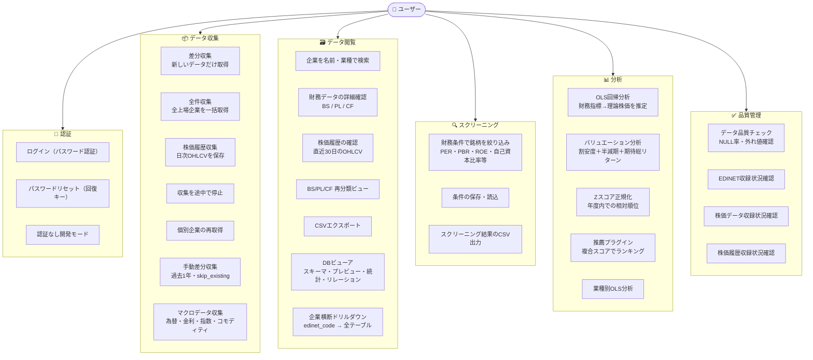

---

## 3. データベース設計（ER図）

> テーブルの主キー・外部キーと、テーブル間の関係を示します。列の定義と説明は `database.py` の各クラスが正本です（図の下の対応表）。
> `||--o{` は「1対多」（1社に対して複数の財務レコードが存在する）を意味します。
> `macro_data` は企業に紐づかない独立テーブル（マクロ環境データ）です。
>
> **計算結果と生データのDB分離（重要）**:
> - `financial_records` は **ソース（XBRL再分類＋市場スナップショット）のみ**を保持する。
> - 軽い派生指標（営業利益率・ROE・自己資本比率・D/E・CF比率・研究開発/減価償却集約度・ネットキャッシュ・各Zスコア・成長率）は
>   **`financial_metrics` VIEW がソース列から都度SQL算出**する（DBに永続化しない＝関数型）。
> - 重い派生（OLS予測値 `predicted_market_cap` / `gap_ratio`）は **`regression_results` テーブル**に隔離保存する。
> - アプリの読み取りは ORM `FinancialMetric`（VIEW）経由で、ソース＋派生＋予測値をまとめて取得する。
>   VIEW の計算は Supabase 側で走るため Render の CPU を消費しない。
> - **上場状態（`is_active`/`delisted_date`、Issue #315）**: `companies` を LEFT JOIN して VIEW へ合成。
>   `collect_stock_price_history_jquants`（夜間の J-Quants catchup・`_pipeline_incremental.py`）が J-Quants `/equities/master`
>   （現在の上場銘柄集合・実測4,446銘柄）と突合し `sync_active_status()`（database.py）で自動更新する。
>   v1 の `/markets/listed/info` は **v2 に存在せず**、#425 の v2 移行以降この同期は停止していた（#462）。
>   マスタは東証銘柄だけを載せるので、**札証・福証の単独上場（`yahoo_suffix` 解決済み・#555）は株価で判定する**（#779）:
>   最終足が `PRICE_STALE_ALERT_BDAYS` 以内で、マスタの as-of より後に出来高>0 の足がある社は delisted にせず、
>   delisted なら復帰させる（戻り値 `price_alive`）。東証の社はマスタ突合と #463 の `protected` だけで判定する。
>   「今買える銘柄」を選ぶプラグイン（recommend / gap_analysis / net_cash_analysis）と
>   sell_ranking の**標準化の基準となる母集団**は `database.tradable_filters(db)` で対象を絞るが、
>   **backtest は今の上場状態ではフィルタしない**（as-of の start_date 時点の候補を「現在」の上場状態で絞ると
>   生存者バイアスを逆向きに持ち込むため）。代わりに `backtest.tradable_at_start` が、開始日の時点で分かっていた
>   事実だけで「開始日に買えた社」へ絞る（開始日の `ASOF_PRICE_WINDOW_DAYS` 日前〜開始日に週次の終値がある社・#1242。
>   外した数は応答の `n_untradable_at_start`）。**同じ窓の最後の終値で、株価を使う列を開始日の値へ作り直す**（#1248）:
>   as-of の行の `market_cap`・`div_yield` は毎晩の収集が今の株価で上書きし、`gap_ratio` は毎晩の回帰が今の株価で
>   作るので、そのまま順位を付けると「開始日から今までに値下がりした社ほど割安に見える」（6 か月前の開始日で、保存
>   された株価が開始日の終値から 3% 超ずれる行が 82%）。時価総額・配当利回りは毎晩の収集と同じ
>   `_compute_market_values` へ開始日の終値を渡して VIEW と同じ分割補正（`COLUMN_DIRECTION`）を当て、gap_ratio は
>   開始日 1 日分の業種別回帰（`sector_gap_asof.gaps_on`）で作り直す。時価総額の下限もこの値で掛ける。
>   sell_ranking のユーザー入力の保有銘柄自体は
>   除外せず情報表示のみ（`is_active` を行の属性として返す）。
> - **価格が止まった社の除外（Issue #605）**: `is_active` だけでは足りない。`/equities/master` の
>   as-of は「今日−84日」（J-Quants のエンバーゴ）で、**廃止の反映が最大12週遅れる**。
>   実測（2026-09-04）では値の付かない29社が `is_active=True` のまま残り、`regression_results`
>   29社 / `macro_beta_loadings` 28社 / `macro_enet_scores` 6社へ入って μ̂ 付きで推奨候補に
>   並んでいた（#315 の生存者バイアスの裏返し＝ゾンビ銘柄）。`delisted_date` の実測は
>   「as-of が停止日を追い越した日」と一致し、毎日1〜5社ずつ落ちる待ち行列になっている。
>   マスタは自分の as-of より後のことを証言できない（#463 が逆向きで書いたのと同じ制約）が、
>   **価格が止まったという事実は今日わかる**ので、判定を「マスタ収載」から「価格が生きている」へ
>   寄せた。閾値は `PRICE_STALE_ALERT_BDAYS`（=10営業日）を再利用する——`price_freshness` が
>   「この結果で発注しない」と言う線と別に持つと片方だけ動いたときに黙ってずれる。WARN(=5)は
>   連休や一時取得失敗で生きた銘柄を落とす危険が最も高い（#555 と同型の静かな欠測）。
>   価格行を1本も持たない銘柄は落とさない（判定できるのは「止まった」であって「無い」ではない）。
>   4経路が同じ `tradable_filters` を共有することは `tests/test_tradable_universe.py` が AST で
>   縛る——1箇所だけ直すと「推奨には出ないが売却候補には出る」形で静かに食い違う。
> - **計算の母集団も同じ判定を共有する（Issue #780）**: #605 が直したのは表示母集団だけで、計算には
>   廃止・停止の社が残っていた。次の3つも `tradable_filters` を共有する（同じく AST で縛る）。
>   - **sector_ols の当日回帰**（既定・`year` 指定）: `financial_records`＋`companies` の JOIN を読むので、
>     `tradable_filters(db, is_active=Company.is_active, edinet_code=FinancialRecord.edinet_code)` と列を
>     渡して掛ける。実測（2026-10-02）で廃止25社・停止17社が最終株価のまま回帰に入り、整理銘柄の暴落価格
>     （`stock_price=1.0` → gap +47,963%）が業種の係数と α を通じて現役社の gap を動かしていた。外すと
>     現役社の gap は全体で順位相関 0.991・中央値 0.79pt 動き、ridge の α が切り替わった4業種
>     （輸送用機器 100→1000 ほか）で最大 1,092pt 動いた（α が平坦な谷で跳ぶ問題は #761）。
>     **時点再現（`all_years=True`・`sector_gap_asof`）には掛けない**——「その月末に週次の足を持つ社」で
>     もともと廃止社を含まず、今日の上場状態で絞ると生存者バイアスになる。今回の変更で本番の当日回帰が
>     学習パネルの母集団に揃った（だから `PREPROCESS_VERSION` は上げていない）。外した社の
>     `regression_results` の既存行は消さない（表示は `tradable_filters` が隠す）。これに対し、**読んだのに
>     回帰に入らなかった上場中の社**（採用列の空欄・業種が `min_samples` 割れ等）の行は消す（#905・ADR-0066）
>     ——隠す仕組みが無いので、前回までの乖離率が乖離分析と推奨に出続けるため。
>   - **sell_ranking の `mu` / `neg_r_macro` の標準化基準**: producer の全行ではなく universe にいる社の μ̂。
>     M-6 では 1,719行のうち77行が外れ、標準偏差が 0.0642 → 0.0559 になった。
>   - **producer の代表 as-of**（M-2・M-3・M-6・M-4）: μ̂ の行は全社ぶん保存したまま（読み手が各自の
>     母集団で絞る）、as-of だけを `macro_snapshots.tradable_snapshot_asof` で今買える社から作る。社ごとの
>     スナップ日は保存しないので絞れるのは保存時だけ。除く社は `database.non_tradable_codes`
>     （`tradable_filters` の否定）。全社が落ちたら全社で代表させる（「未蓄積」ではなく古さを見せる）。
>   - `macro_beta_loadings`（M-1 の学習データ）には掛けない（階層ベイズのプーリングは過去の社を要する・#315）。
> - **分析タブの結果表も同じ判定を通す（Issue #806）**: #605・#780 は推奨系と計算の母集団を揃えたが、
>   **M 系の `execute` が返す `results` そのもの**が読み手であることは扱われていなかった。M 系の「現在」の
>   μ̂ は社ごとに最終週次バーで作るので、株価が止まった社は止まった日付のまま並ぶ。線形の M-6 では
>   その日付のマクロ値が全社共通の定数として μ̂ を押し上げ、実測（2026-10-04）で上位10が全部・上位30の
>   23社が廃止社だった（最終バーの月ごとの M-6 μ̂ 平均は 2025-06 の +0.187 から 2026-10 の −0.225 へ
>   ほぼ単調に下がる。木の M-2 は外挿しないので段差が出ない）。OOF rank-IC が検証したのは同じ月の中の
>   順位なので、日付の違う社を混ぜた表は検証の外にある。M-1/M-2/M-3/M-4/M-6 は**永続化の後に**
>   `macro_snapshots.tradable_results` で表だけを絞り（保存する μ̂ は全社のまま）、内訳
>   `untradable_excluded`（上場廃止 / 価格停止。`database.non_tradable_breakdown` が `non_tradable_codes`
>   に理由の札を付ける）を画面へ1行出す（`analysis.js::_showUntradableNote`。結果本体は λ 変更で
>   描き直されるので注記は本体の外に置く）。M-3 は絞ってから `top_n` を取り、α/β 経路も表示する社に付ける。
>   呼び出しは `tests/test_tradable_universe.py::TestResultsUseTradableResults` が AST で縛る。
>
> **`nightly_model_diagnostics`（#726・[ADR-0061](adr/0061-nightly-keeps-the-diagnostics-it-already-computes.md)）**: 夜間の producer が毎晩計算して捨てていた診断値（`sector_ols` の業種別 ridge α・R²・VIF 警告、`macro_enet` の CV が選んだ α / l1_ratio と α パスの端・OOF 成績・係数）を run_id × model で1行ずつ**追記**する。書き手は `nightly_scores.py` だけで、μ̂ / gap_ratio の検証が済んだ後に書き、直接クエリで確かめる（書けなければ `<model>:diagnostics` で非ゼロ終了）。入れるのは `DIAG_EXTRACTORS` の allowlist だけ（社別の行・社名は入れない）。**本番のスコアも起票もこれを読まない**——読み手は `python -m scripts.nightly_diag_report` だけ。
>
> **`prediction_snapshots`（#1005・親 #1001）**: 全置換で最新しか持たない `*_scores`（μ̂）と `regression_results`（gap_ratio）を、月に1回その時点の値のまま (写した日 × 源 × 社) で**追記**する。源は永続化している全ての mu_source（`macro_enet` / `macro_gbdt` / `macro_dlm` / `macro_risk_return`）と `sector_ols` の gap と売り専用の候補 S2（源 `sell_quantile`・値は `mu` 列に q20・M-6 と断面の日付がそろう夜だけ写す・#1208）（退役した M-4 は除く）。書き手は `prediction_snapshots.snapshot_month` だけで、夜間バッチ（`nightly_scores.py`）が全モデルの後に呼び、**源ごとに当月分が無いときだけ**写す（初回の夜に失敗しても翌晩に取り直す）。読む入口は画面・売りランキングと同じ（`read_producer_scores`・各社の最新年度の `financial_metrics.gap_ratio`）で、新しい推定はしない。空・読めない源は `prediction_snapshots:<源>` で非ゼロ終了（**S2 の空だけは見送り**＝予測が全社同値の夜は表が空で全置換されるので失敗にせず、翌晩また試す・`EMPTY_IS_NORMAL`）、接続先がローカルでなければ写さない（行はローカル正本だけ）。表は `init_db()` を待たず書き込み側でも `checkfirst` で作る。手で写すときは `python -m prediction_snapshots`（`--dry-run` で行数だけ）。前進は `batch_freshness.PRODUCERS`（源ごとの最新の写しの最古・月の最長31日＋夜間の窓）が見る（見る源は `prediction_snapshots.WATCHED_SOURCES`＝S2 を除く。仕様どおり空の月に起票しないため・#1208）。答え合わせは `scripts/measure_live_oos.py`（#1157・読むだけ）で、52 週の起点は写した日（`data_asof` ではない）。
>
> **`jpx_listing_snapshots`（#1004・親 #1001）**: 東証上場銘柄一覧（data_j）の月次断面を (源 × 時点 × 証券コード) で積む。JPX は過去版を配らないので、取り逃した月は永久に欠ける。書き手は `collector_master.record_jpx_listing_snapshot` だけで、夜間 Phase 5 の `update_industry_from_jpx` が**業種用に取ったのと同じダウンロード**から、業種の更新の後に呼ぶ（失敗は WARNING＝業種は止めない）。列は見出しの名前で引き（`collector_utils.JPX_SNAPSHOT_COLUMNS`）、市場・商品区分・33業種区分・規模コード・規模区分は生値のまま。`edinet_code` は書き込み時点の企業表で解決する（ETF 等は NULL のまま残す）。書く前の健全性（行数・規模区分の語彙・'-' 以外の件数・日付が1種類）が外れたら書かない。同じ時点は上書きせず `last_seen_at` だけ進め、中身が違えば WARNING と差の件数を出す。**可視判定は `first_seen_at`**（`database.jpx_listing_snapshot_at`）。前進は `batch_freshness.PRODUCERS` が2本で見る（取得＝毎晩の `last_seen_at`・時点＝`as_of_date` が月の最長31日＋公表遅れ `JPX_LISTING_PUBLICATION_LAG_DAYS` を超えて止まっていないか）。断面の記録の後、`collector_master.update_company_market` が最新の断面から `companies.market`（最新の表示用）を変わった社だけ埋める（#1015・別名表 `JPX_MARKET_ALIASES`・年度の行は埋めない）。
>
> **producer/consumer 系の補助テーブル**: `macro_beta_meta`/`macro_beta_loadings`（ADR-0002・
> `macro_beta_inference.py` が月次バッチで書き込み、`plugins/macro_risk_return.py` が読む）、
> `recommend_factor_premia`（ADR-0008・`recommend_factor_premia.py` が書き込み、
> `plugins/recommend.py::resolve_weights()` が「統計的最適化」プリセットとして読む）、
> `plugin_tuned_params`（ADR-0007・`hyperparameter_search.py` が書き込み、
> `GET /api/plugins/{name}/tuned` が読む。**保存値は「そのとき探索した空間」の記録**なので、
> 読む側が `project_tuned_params()` で現在の探索空間へ射影してから返す——`base_params` の
> キーはその値で上書き、dims にある軸は保存値のまま、どちらにも無いキーは落として
> `params_schema` の既定へ倒す。生値は `params_as_tuned`、扱いが変わったキーは
> `stale_params` に載せ、画面が注記として出す。**射影が無いと、探索から外した軸の古い値が
> 「🔧 自動調整済み」として推奨され続ける**＝M-1 のモメンタムが実際にそうなっていた。
> **射影が見るのは探索空間の形だけで、パネルの世代は別の目で見る**（#711・ADR-0047）——
> `current_panel_fingerprint()` が `hyperparameter_search._data_fingerprint()`（規則の唯一の源・
> TTL 60秒のキャッシュで1ページ読込3回を1回へまとめる）を呼び、保存時の `data_fingerprint`
> と比べた結果を `panel_changed`（True=違う / False=同じ / None=判定不能）として返す。
> 画面は **False と積極的に言えたときだけ**自動プリフィルする＝指紋を持たない古い行も、
> 指紋を読めなかった回も、自動適用しない。**パネルは毎晩伸びるので自動適用は事実上ほぼ
> 止まる**が、バッジと「調整済みの値に戻す」ボタンは残るので手動適用の導線は生きている。
> これが無いと、いま探索中の軸に残った古い値が素通りする——M-1 の `max_features=5`
> （2026-09-02・分割補正前のパネル）は rank-IC +0.0052・fold 間 std 0（予測値が月内で
> 全銘柄同じ）だったのにプリフィルされ続けた。その後 #791 で `max_features` を探索軸から
> 外して `base_params` に本番既定 20 を固定したので、この値は今は射影が 20 へ倒す
> （軸が無くなった M-1 の探索は μ̂ の永続化のための1候補で完走する）。
> ADR-0050・#604）は、いずれも「重い推論/探索バッチが結果だけを
> 永続化し、軽量なAPI/プラグインが読む」producer/consumer 分離パターン（`regression_results`
> と同型）。`statement_disclosure`（Issue #322・`collector_disclosures.py` が J-Quants
> `/fins/summary` から蓄積する生データ）は**会社予想の中身を分析に使っていないが、収集は止めない**。
> 読み手は2つある: ①収集の途中で `ShOutFY` を拾い `companies.issued_shares` を更新する
> （発行済株式数の J-Quants 経路の唯一の入口・`collector_prices._update_issued_shares`・#462）
> ②夜間の TTM 合成が会計基準と連結・単体の別を読む（`ttm_composite._load_basis`・ADR-0051）。
> **`disc_date` は常に `today − 84日` が天井**（`JQUANTS_DISCLOSURE_DELAY_DAYS`＝無料プランの
> 構造的上限）で、収集頻度を上げても前進しない＝齢を「壊れている」と誤診しないこと（#424 子4）。
> 予想対比サプライズの特徴量化層 `feature_disclosure.py` は、唯一の予定消費者 #323 が not planned で
> 閉じ、呼び出し元も無くなったので #1290 で退役した（取り出し方は `docs/archive/IMPROVEMENTS.md`）。

```mermaid
erDiagram
    companies {
        int    id          PK
        string edinet_code UK
    }

    financial_records {
        int    id          PK
        string edinet_code FK
    }

    regression_results {
        string edinet_code PK
        int    year        PK
        string period_end  PK
    }

    split_adjustment_factors {
        string edinet_code PK
        int    year        PK
    }

    ttm_financial_records {
        int id PK
    }

    jquants_adj_factor_events {
        string edinet_code PK
        string event_date  PK
    }

    jquants_adj_factor_coverage {
        string edinet_code    PK
        string first_bar_date PK
        string last_bar_date  PK
    }

    macro_gbdt_scores {
        string edinet_code PK
    }

    macro_dlm_scores {
        string edinet_code PK
    }

    macro_ensemble_scores {
        string edinet_code PK
    }

    macro_enet_scores {
        string edinet_code PK
    }

    sell_quantile_scores {
        string edinet_code PK
    }

    macro_beta_meta {
        int    id     PK
        string run_id UK
    }

    macro_beta_loadings {
        int id PK
    }

    recommend_factor_premia {
        int id PK
    }

    jpx_listing_snapshots {
        string source     PK
        date   as_of_date PK
        string sec_code   PK
    }

    prediction_snapshots {
        string snapshot_date PK
        string source        PK
        string edinet_code   PK
    }

    trade_ledger {
        int id PK
    }

    nightly_model_diagnostics {
        int id PK
    }

    plugin_tuned_params {
        string plugin_name PK
    }

    stock_price_daily {
        string edinet_code PK, FK
        string trade_date  PK
    }

    stock_price_weekly {
        string edinet_code PK, FK
        string week_start  PK
    }

    collection_logs {
        int id PK
    }

    app_settings {
        string key PK
    }

    macro_data {
        int id PK
    }

    xbrl_raw_documents {
        int    id     PK
        string doc_id UK
    }

    statement_disclosure {
        string disc_no     PK
        string edinet_code FK
    }

    companies         ||--o{  financial_records    : "1社 → 複数年度の財務データ"
    companies         ||--o{  stock_price_daily    : "1社 → 直近6か月の日次終値"
    companies         ||--o{  stock_price_weekly   : "1社 → 全履歴の週次終値"
    companies         ||--o{  statement_disclosure : "1社 → 複数回の会社予想開示"
    xbrl_raw_documents }o--|| financial_records   : "doc_id で紐付け（再解析用）"
    financial_records ||--o| regression_results  : "(edinet_code,year,period_end) で1対0..1"
    financial_records ||--o| split_adjustment_factors : "(edinet_code,year) で1対0..1（歪んだ行のみ）"
    financial_records ||--o| ttm_financial_records : "材料3行（前期通期・前期H1・今期H1）から1行を合成"
    companies         ||--o{ jquants_adj_factor_events : "1社 → 公式 AdjFactor のイベント（#661）"
    companies         ||--o{ jquants_adj_factor_coverage : "1社 → 公式バーを受け取った区間（#668・追記）"
    macro_beta_meta    ||--o{ macro_beta_loadings  : "1推論ラン(run_id) → 複数因子ローディング"
```

**表と `database.py` のクラスの対応**（列の定義と説明は各クラスが正本。図には主キー・外部キー・単一列の一意キーだけを載せ、複数列の一意制約は載せない）:

| 表 | クラス（[database.py](../database.py)） | 役割 |
|---|---|---|
| `companies` | `Company` | 企業マスタ（1社1行・上場状態と Yahoo のサフィックスを持つ） |
| `financial_records` | `FinancialRecord` | XBRL 再分類の財務値と収集時点の市場スナップショット（通期・H1 は `period_type` で区別） |
| `regression_results` | `RegressionResult` | 業種別回帰の予測時価総額と乖離率（`financial_metrics` VIEW が結合する） |
| `split_adjustment_factors` | `SplitAdjustmentFactor` | バリュエーション列の分割補正係数 F と基準の遅れ（毎晩全置換・ADR-0055） |
| `ttm_financial_records` | `TtmFinancialRecord` | 直近12か月（TTM）の合成行（毎晩全置換・ADR-0051） |
| `jquants_adj_factor_events` | `JQuantsAdjFactorEvent` | J-Quants の公式 AdjFactor のイベント（最新年の分割倍率の出どころ） |
| `jquants_adj_factor_coverage` | `JQuantsAdjFactorCoverage` | 公式の日次バーを受け取った区間（公式の不在を判定する根拠） |
| `macro_gbdt_scores` | `MacroGbdtScore` | M-2 の μ̂（最新のみ・全置換） |
| `macro_dlm_scores` | `MacroDlmScore` | M-3 の μ̂（最新のみ・全置換） |
| `macro_ensemble_scores` | `MacroEnsembleScore` | 退役した M-4 の μ̂（ADR-0044） |
| `macro_enet_scores` | `MacroEnetScore` | M-6 の μ̂（最新のみ・全置換） |
| `sell_quantile_scores` | `SellQuantileScore` | 売り専用の予測 S2（52週先リターンの下側20%点・ADR-0076） |
| `macro_beta_meta` | `MacroBetaMeta` | M-1 の推論ラン1回分のメタ情報（収束ゲートの結果 `status` を含む） |
| `macro_beta_loadings` | `MacroBetaLoading` | M-1 の銘柄×因子の事後ローディング |
| `recommend_factor_premia` | `RecommendFactorPremium` | 推奨の「統計的最適化」プリセットの因子プレミアム（ADR-0008） |
| `jpx_listing_snapshots` | `JpxListingSnapshot` | 東証上場銘柄一覧の月次断面 |
| `prediction_snapshots` | `PredictionSnapshot` | 予測の月次の写し（追記のみ・答え合わせ用） |
| `trade_ledger` | `TradeLedgerEntry` | 売買の記録（追記のみ・訂正は取消の行） |
| `nightly_model_diagnostics` | `NightlyModelDiagnostic` | 夜間の producer の診断値（追記のみ・ADR-0061） |
| `plugin_tuned_params` | `PluginTunedParams` | 自動調整の最新のベストパラメータ（ADR-0007） |
| `stock_price_daily` | `StockPriceDaily` | 直近6か月の日次終値と出来高 |
| `stock_price_weekly` | `StockPriceWeekly` | 全履歴の週次集約（終値・出来高・売買代金） |
| `collection_logs` | `CollectionLog` | 収集ジョブの実行記録 |
| `app_settings` | `AppSetting` | アプリ設定のキーと値 |
| `macro_data` | `MacroData` | マクロ系列の日次（企業に紐づかない） |
| `xbrl_raw_documents` | `XbrlRawDocument` | XBRL の全行を gzip で保存した原本（再解析用） |
| `statement_disclosure` | `StatementDisclosure` | J-Quants の決算短信サマリー（会社予想・期末株式数） |

> **`financial_metrics`（VIEW・物理テーブルではない）**: `financial_records` をソースに、
> `op_margin` / `net_margin` / `roe` / `roa` / `equity_ratio` / `interest_bearing_debt` / `de_ratio` / `cf_ratio` /
> `asset_turnover`（総資産回転率＝売上/総資産・デュポン分解因子・M-1 特徴量） /
> `rd_intensity` / `da_intensity`（研究開発・減価償却の対売上集約度 [%]・C2列の結線） /
> `net_cash` / `nc_ratio` / `z_*`（8指標）/ `rev_growth` / `op_growth` / `eps_growth` /
> `accruals`（＝(純利益−営業CF)/総資産・Sloan 質因子・#373） /
> `delta_roe` / `delta_op_margin`（前年差 [%pt]・`LAG` で改善/悪化トレンド・#373） /
> `z_roe_sec` / `z_op_margin_sec`（**業種内**Zスコア・`PARTITION BY year, industry`・#373）を
> SQL で都度算出し、`regression_results` を LEFT JOIN して `predicted_market_cap` / `gap_ratio` も合成する。
> 算出式は旧 `collector.calc_derived` / `_calc_zscore_for_year` / `calc_growth_rates` と一致（移植）。
> `de_ratio` の分子は `interest_bearing_debt`（有利子負債＝借入金と社債の構成要素の和・リース債務は除く・#926）。
> 足す列の唯一の源は `database.INTEREST_BEARING_DEBT_COLUMNS` で、VIEW 3本の式は d の層で1か所だけ作り、
> `de_ratio` は n の層でそれを読む（同じ SELECT では別名を読めないため）。企業詳細の BS グラフ
> （`serializers.record_to_dict` の `interest_bearing_debt` / `interest_bearing_debt_current`）と `calc_derived` も
> 同じ列を読む。**銀行業・保険業の行は `de_ratio` が NULL**（借入金の区分を持たず 0＝無借金に見えるため・
> `database.DE_RATIO_EXCLUDED_INDUSTRIES`・ADR-0067）。
>
> **株価由来の列はここで基準を揃える（#655・[ADR-0055](adr/0055-valuation-basis-mismatch-is-corrected-in-the-view.md)）**:
> `split_adjustment_factors` を LEFT JOIN し、`per` / `pbr` / `market_cap` に `× F`、`div_yield` に `÷ F` を当てる。
> `financial_records` の生値は[[バリュエーション基準の不一致]]を抱えたまま書き換えない（F には登録済みの
> 株式分配型スピンオフも入る・#740）。期末後分割の年の行は F ではなく基準の遅れで直し、`market_cap` に
> `shares_lag` を掛け、`div_yield` を `dps_lag` で割る（列と遅れの対応の唯一の源は `corporate_actions.BASIS_LAG_COLUMN`・
> #753・決定4-11）。`regression_results` の `predicted_market_cap` にも `shares_lag` だけを掛ける。VIEW を通らない
> `sector_ols` は読込（`_load_records`）で同じ遅れを当て、`market_cap` は生のまま読む（#758・決定4-12）。
> `nc_ratio` / `z_nc_ratio` は補正後の `market_cap` から計算される。適用した F と遅れは `split_factor` /
> `split_shares_lag` / `split_dps_lag` 列で露出する（消費側が重ねて掛けない）。`stock_price` は補正しない（意図した非対称）。
> 係数表は毎晩の `_pipeline_incremental.py` の Phase 4 直後と、手動の全件実行 `_pipeline_gh.py` の
> `point_in_time=True` 版の直後で全置換される（決定5）。F は「その行の年より後に起きたイベントの累積積」なので、
> 新しい分割1件で過去全行の値が変わる。検出（第1経路・第2経路とその交差検証・期中と期末後の分解・欠損年またぎの
> ペアの除外・公式の不在による除外）は企業イベント台帳 `corporate_actions.py`（ADR-0062）が持ち、
> `jquants_adj_factor_events`（最新年の倍率）・`jquants_adj_factor_coverage`（公式の日次バーを受け取った区間）・
> `stock_price_weekly`（系列の空白）を読む。作り直しは J-Quants を叩かない。各経路の規則と理由は ADR-0055 の
> 決定4-5・4-7・4-8・4-10・4-13、症状と実測は [GOTCHAS.md](GOTCHAS.md)「per / pbr の分割補正」。
> **通期のみを露出（`WHERE period_type='annual'`・Issue #219② フェーズA）**: 半期(H1)等の非通期行を
> `financial_records` に同居させても、年度単位の Zスコア（`PARTITION BY year`）・成長率 LAG
> （`ORDER BY year, period_end`）が期間混在で壊れないよう VIEW 段でソースを通期に限定する。
> 全プラグインはこの VIEW 経由のため、非通期行の導入後も挙動は完全不変。非通期行は
> `period_type<>'annual'` で別途参照する（下記 `financial_metrics_interim`）。

> **`financial_metrics_with_ttm`（VIEW・#424 子2・ADR-0051）**: 通期の行と [[TTM 行]]（直近12か月の
> 合成）を `basis` 列（`annual` / `ttm`）付きで並べる VIEW。**`financial_metrics` は変えない**——
> あちらは画面・スクリーニング・M-1〜M-6・推薦・バックテストの共通の入口で、TTM を混ぜると測る前に
> 全部の結果が変わる。読むのは学習パネルが `plugins.macro_snapshots.use_fin_rows("with_ttm")` の内側で
> 読むときだけで、**既定は通期のみ**（昇格ゲート＝子3 は未実施）。比率・Zスコア・成長率の式は
> `financial_metrics_view.sql` と同じ文面で、違いは 4 つ: ①入口が UNION ALL（通期＋`ttm_financial_records`）
> で F と基準の遅れ（#753）が行ごとに来る（TTM 行の遅れは 1.0＝期末後分割の年は TTM の材料にならない）②窓が `(year, basis)` / `(year, industry, basis)` / `(edinet_code, basis ...)`
> ③TTM 行の成長率・前年差は直前の行が前年度のときだけ出す ④`regression_results` は通期の行にだけ結合。
> TTM 行の id は負（`financial_records.id` と衝突させない）。読み取り ORM は `FinancialMetricWithTTM`
> （`FinancialMetric` の列＋`basis`＋`filing_date`）。通期の行が `financial_metrics` と一致することは
> 実 PostgreSQL の双方向 `EXCEPT` で確かめる（`tests/test_financial_metrics_with_ttm_postgres.py`）。

> **`financial_metrics_interim`（VIEW・Issue #219② フェーズC）**: `financial_metrics` と対をなす
> **非通期（半期H1等）専用**の読み取り VIEW。ソースは `financial_records` の `period_type<>'annual'`
> 行のみ。行単位比率（`op_margin`〜`nc_ratio`）は通期版と同一式で算出し、`period_type` / `filing_date`
> を露出（`filing_date` は #323 の point-in-time リーク防止基準）。成長率は**同一 period_type の
> 前年同期比**（`LAG OVER (PARTITION BY edinet_code, period_type ORDER BY year, period_end)`＝H1 vs
> 前年 H1）。Zスコア（年度内クロスセクション）・`regression_results` JOIN（通期OLS予測）は**持たない**
> （#323 は独自正規化・年次OLS予測は H1 に非該当）。用途は #323 イベント駆動モデルへの H1 実績
> ファンダ供給で、#322(/fins/summary)に無い `roe`/`roa`/`asset_turnover`/`equity_ratio`/`cf_ratio` 系を
> 充足する。読み取り ORM は `FinancialMetricInterim`。市場データ（`market_cap`/`per` 等）は H1 未収集
> のため市場依存派生（`nc_ratio` 等）は NULL になりうる。実データ充足率: 主要比率 98〜100%
> （一部 IFRS 大手で `pl_revenue` 欠落＝売上依存派生のみ影響）。

---

## 4-1. 財務データ収集フロー

> 「収集開始」ボタンから完了までの処理の流れです。

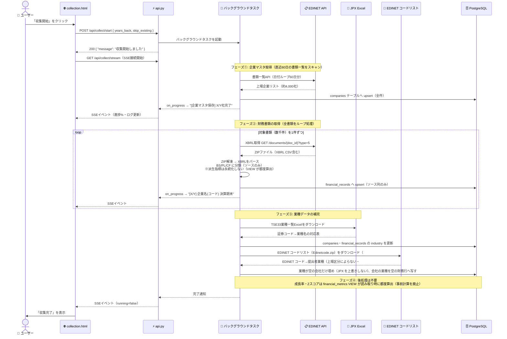

---

## 4-2. 株価履歴収集フロー

> 株価を取得し、**close-only の2本立て**（`stock_price_daily`＝直近6か月の日次／`stock_price_weekly`＝全履歴の週次集約）へ保存するフローです。容量恒久対策（Supabase Free 500MB）として旧 `stock_price_history`（日次OHLCV全履歴）から移行。詳細は [DEPLOYMENT.md「容量設計」](DEPLOYMENT.md#容量設計株価--最大の消費者) 参照。

**現在の経路**: 夜間バッチ（`_pipeline_incremental.py` の Phase 4）が ①Yahoo で直近の欠損を補完（`fill_recent_stock_price_gap_yahoo`）→ ②J-Quants catchup で 80〜90日前を公式値へ置き換え（`collect_stock_price_history_jquants`）→ ③`update_market_data_from_history` で `financial_records` へ反映する。stooq はクラウド IP だけでなくローカルからも JavaScript のボット検証ページ（HTTP 200）を返し、CSV は取れない（2026-09-25 実測・[GOTCHAS.md](GOTCHAS.md)）。下は画面から手動で J-Quants 収集を回すときのフロー。

**フロー概要**（4-1 の財務収集と同じ起動パターン）:
1. `POST /api/collect/jquants/start { days_back }` → バックグラウンドタスク起動 → 200 即返し
2. UI が `GET /api/collect/jquants/stream` で SSE 接続
3. BGT が `SELECT edinet_code, sec_code FROM companies WHERE sec_code IS NOT NULL` で企業一覧取得
4. 日付ループ（J-Quants: 日付単位で全銘柄一括取得・`JQUANTS_RATE_SLEEP=20秒`）
5. 単一チョークポイント `record_prices_batch`（database.py）で **①daily upsert → ②触れた週のみ daily から weekly を再集約 upsert（aggregate_weeks）→ ③daily を直近 `DAILY_WINDOW_DAYS` で trim**。株価を書く経路（J-Quants/Yahoo。stooq は #736 で撤去）はすべてここを通る。専用スケジューラ不要（収集に相乗り）
6. `on_progress` → SSE で進捗配信 → 完了後 `running=false`
7. UI が `GET /api/collect/history/coverage` で収録状況を更新表示

制約値・優先度ルールは [DEPLOYMENT.md「外部サービス制約」](DEPLOYMENT.md) 参照。

### `close` 列のスケールを1つに保つ選別（#620・ADR-0053）

`stock_price_daily.close` は**2人が書く列**である。毎晩の差分収集（`_pipeline_incremental.py` Phase 4）で
Yahoo gap-fill が直近セッションを、J-Quants catchup が `today-90 〜 today-80` を書く。どちらも
「調整済み終値」だが調整に含まれるイベントが違うため（Yahoo は無償割当を splits として持たない・#466）、
そのままでは調整差のある社で**帯の両端に企業イベントではない段差**ができる。

そこで `_jquants_batch_gen`（collector_prices.py）は、返ってきた行の未調整 `C` と調整後 `AdjC` を
`collector_utils.rounding_tolerance` の許容で突き合わせ、**食い違う行を書かない**。

| 経路 | 何を数えるか | どこに出るか |
|---|---|---|
| `AdjC != C` | `scale_mismatch`（行）＋ `scale_mismatch_companies`（社） | catchup ログ・戻り値 |
| `C` が無い | `scale_unknown`（行） | WARNING（API 仕様変化の合図） |
| 登録済みスピンオフの権利落ち前（#651） | `spinoff_unadjusted`（行）＋ `spinoff_unadjusted_companies`（社） | catchup ログ・戻り値 |
| 往復段差 | 上の社と交差した結果 | Phase 4 末尾の1行 |

スピンオフの行は `AdjC == C` のまま上の選別を素通りするので、`corporate_actions.SPINOFF_ADJUSTMENTS`
の登録から `before_spinoff_ex_date` で判定して書かない（係数を掛けて書かない＝登録の誤りを本番値へ
入れない・ADR-0053 追記）。この生成器は手動の J-Quants 収集（`/api/collect/jquants/start`・
`_pipeline_gh.py --finalize-only`）も通るので、選別は毎晩の catchup に限らず効く。

往復段差の検知（`detect_roundtrip_scale_bands`）は段差の抽出を **SQL の `LAG` で DB 側に寄せる**
（全社の日次を素で引くと約68万行を毎晩転送することになる）。**形だけでは本物を選べない**ので、
毎晩の判定は「その晩 `AdjC != C` を報告した社」との交差で行う（`only_ecs`）。既に入っている帯は
`scripts/repair_scale_mixture.py` が公式突合で確定させてから Yahoo で取り直す。

交差は社単位なので、突合で**非該当**と決まった帯は `app_settings.scale_band_verdicts`（JSON・
キーは `database.KEY_SCALE_BAND_VERDICTS`）に記録し、夜間は `exclude_judged_bands` で除いてから数える
（#644）。書き手は `repair_scale_mixture`（ドライランでも書く）、読み手は Phase 4 の検知で、書式は
`collector_prices` の `record_scale_band_verdicts` / `load_judged_scale_bands` が一手に持つ。鍵は
`(edinet_code, start, end, 往き比, 戻り比)` で、帯の値が書き換われば再び警告される。判定不能の帯は
記録しない。保持窓（`DAILY_WINDOW_DAYS`）の外へ出た帯は書き込み時に掃除する。

判定済みの除外の**前に**、開始日が `collector_utils.OFFICIAL_SCALE_WRITABLE_UNTIL`（2026-06-20）より後の帯を
`exclude_unmixable_bands` で落とす（#773）。#620 以降は J-Quants の値を日次へ渡す唯一の経路
（`collect_stock_price_history_jquants`）が選別を通るので、それより後に始まる帯は公式スケールで書かれようがない
（境界の導き方と、今の catchup 窓を変えても動かさない理由は ADR-0053）。状態を持たないので、分割の波で
`AdjC != C` の社が急増した晩も突合なしで黙る。ログの往復段差の行は「2026-06-20 より後に始まる帯 N帯を除外・
判定済みの非該当 M帯を除外」をどちらも 0 でも出し、`check_nightly_collect` は前者を「往復段差 構造除外」の列で
読む。境界以前の行が保持窓から消えるとこの検知は構造上鳴らなくなるので、退役を #775 で扱う（時期と事例は
[GOTCHAS.md](GOTCHAS.md)「株価のスケール（1）」）。

### 取引では起こりえない段差を書かない（#765・ADR-0053 追記）

Yahoo は TOB 後のスクイーズアウトの株式併合を split として登録し、比率倍の終値を返す（事例と値の正体は
[GOTCHAS.md](GOTCHAS.md)「株価のスケール（2）」）。上場廃止で系列が止まるので、書くと異常値が「最新株価」として
固定される。そこで **Yahoo の株価の書き手は、DB の直前値と `SCALE_BREAK_RATIO`（100倍・導き方は ADR-0053 の追記）
以上離れた値を書かない**。J-Quants の経路には掛けない（`record_prices_batch`
に置くと、DB の直前値が汚れているとき公式値まで弾く）。DB の値は「書かない判断」にだけ使い、
何を書くかは決めない。

| 書き手 | 基準 | 段差があったとき |
|---|---|---|
| gap-fill（夜間） | `latest_prices`（日次の最終行・無ければ週次） | **離れたバーだけ**捨てる（`scale_keep_mask`）。基準の無い社は応答内に段差があれば全部捨てる |
| `backfill_weekly_history_yahoo`（月次） | その社の最古の週次終値（取る範囲の後ろ） | 社ごと書かない |
| `repair_price_scale_breaks`・`repair_scale_mixture`（手動） | `latest_prices` | 社ごと書かない（範囲をまとめて書き換える道具なので一部だけ書かない） |

gap-fill が社ごと捨てないのは、捨てた社は最終日付が進まず毎晩同じ直近数日を取り直すから
（実例は ADR-0053 の追記）。弾いた社は
`app_settings.yahoo_scale_rejections`（`database.KEY_YAHOO_SCALE_REJECTIONS`）に「社＋基準日」で記録し、
**新しく起きたときだけ WARNING**（`classify_scale_rejections`）。弾いた社が無い晩は設定表に触らない。
記録が読めない・書けないときは全社を新規として扱い、株価の収集は止めない。

Phase 4 の末尾では、書き手によらず株価表そのもの（日次＝全行・週次＝全履歴）を `LAG` で走査する
（`scan_price_scale_steps`・掛け算で比べて0除算を持たない）。こちらは状態を持たず、段差が残っている
間は毎晩出る。2行の書式は `scale_rejection_log_line` / `scale_step_log_line` が唯一の源で、
`scripts/check_nightly_collect.py` が読む。既に入った行は `scripts/repair_consolidation_prices.py`
（台帳方式・既定はドライラン）が直す。

続けて、2〜10 倍の**未調整の分割・併合**を探す（`scan_unadjusted_corporate_actions`・#1253）。契約窓から
等間隔の 3 日（`NIGHTLY_PRICE_BREAK_PROBE_MONTHS`）だけ週次の終値を公式 `AdjC` と突合し（`detect_price_scale_breaks`・
約 1 分）、比が分割・併合の比（`corporate_actions.snap_to_canonical`）にそろう社だけを数える。
`WITHHELD_OFFICIAL_ADJUSTMENTS` と `collector_utils.PRICE_BREAK_ACCEPTED` の社は除いて数だけ出す。書式は
`unadjusted_split_log_line` が唯一の源で、`check_nightly_collect` の警告の種類 `unadjusted_splits` になる。
**直さない**（直すのは人が `collector.py --repair-price-breaks --persist` で行う・GOTCHAS「株価のスケール（1）」）。
失敗（J-Quants のキーが無い・応答の異常）は握って「検知に失敗」と出し、収集は続ける。

---

## 4-3. 認証フロー

> `APP_PASSWORD` が設定されている場合のみ認証が有効になります。未設定時は開発モードとして全APIが素通りします。

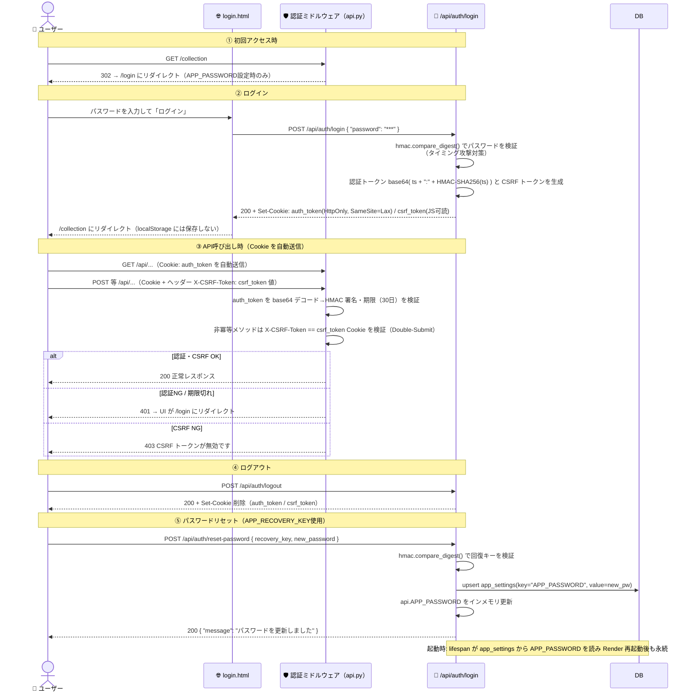

### セキュリティレスポンスヘッダ（`_SecurityHeadersMiddleware`）

全レスポンスに以下を付与する（`api.py`）。

| ヘッダ | 値 | 目的 |
|---|---|---|
| `Content-Security-Policy` | `default-src 'self'; script-src 'self'; style-src 'self' 'unsafe-inline'; connect-src 'self'; img-src 'self' data:; object-src 'none'; base-uri 'self'; form-action 'self'; frame-src 'none'; frame-ancestors 'none'` | XSS・クリックジャッキング・フォーム乗っ取り等の緩和 |
| `X-Content-Type-Options` | `nosniff` | MIME スニッフィング防止 |
| `X-Frame-Options` | `DENY` | クリックジャッキング防止（`frame-ancestors 'none'` と併用） |
| `Referrer-Policy` | `strict-origin-when-cross-origin` | リファラ漏洩抑制 |
| `Permissions-Policy` | `geolocation=(), camera=(), microphone=(), payment=(), usb=()` | 不使用ブラウザ機能の無効化 |
| `Strict-Transport-Security` | `max-age=31536000`（**HTTPS 応答時のみ**。`X-Forwarded-Proto: https` で判定） | プロトコルダウングレード防止 |

> `script-src` は `'unsafe-inline'` を除去済み（インライン `<script>` を `static/js/` へ外部化、インラインイベントハンドラを `data-*` 属性＋イベント委譲へ移行）。`style-src` の `'unsafe-inline'` はインライン `<style>`/`style=` 属性が残るため維持。Chart.js は `static/vendor/chart.umd.js`（npm 公式の v4.4.1）に同梱し、外部のスクリプトは許さない（#1095・版の上げ方は [GOTCHAS.md](GOTCHAS.md)「フロントエンド」）。

### 公開リポジトリ前提の守り（2026-11-01 の点検）

リポジトリは PUBLIC で、ソースも docs も第三者が読める。次の3点は「コードを読まれても破れない」ことを狙う。

| 対象 | 仕様 | 理由 |
|---|---|---|
| ログイン後の遷移先（`static/js/login.js` の `_safeNext`） | `next` をブラウザの `URL` で解釈し、**origin が自分と同じときだけ** `pathname + search + hash` を使う。それ以外と `/login` 自身は `/` | 以前の前方一致の正規表現は `/%09/evil.example` を通した（URL パーサがタブを取り除き `//evil.example`＝別 origin になる）。ログイン直後に偽サイトへ移すオープンリダイレクトになっていた |
| Cookie の `Secure`（`api._cookie_secure`） | `COOKIE_SECURE` を明示すればそれに従い、**未設定なら本番相当（`_is_production_like`）で付ける** | render.yaml の値は Blueprint 管理外のサービスでは反映されないことがある |
| `/docs`・`/redoc`・`/openapi.json`（`api._api_docs_urls`） | 本番相当では出さない。ローカルでは残す | 認証ミドルウェアは `/api/` 配下だけを守るので、既定のままだと全ルートの一覧が未認証で読める |

GitHub 側の第三者入力（Issue・コメント・fork の PR）の扱いは [DEPLOYMENT.md](DEPLOYMENT.md)「ワークフロー失敗の通知」節と [SCRIPTS_REFERENCE.md](SCRIPTS_REFERENCE.md#scriptscheck_batch_freshnesspy) を参照。

---

## 4-4. 業種別OLS分析フロー

> 業種ごとに個別OLSを実行して理論価格を推定し、乖離率（割安・割高度合い）を計算するフローです。

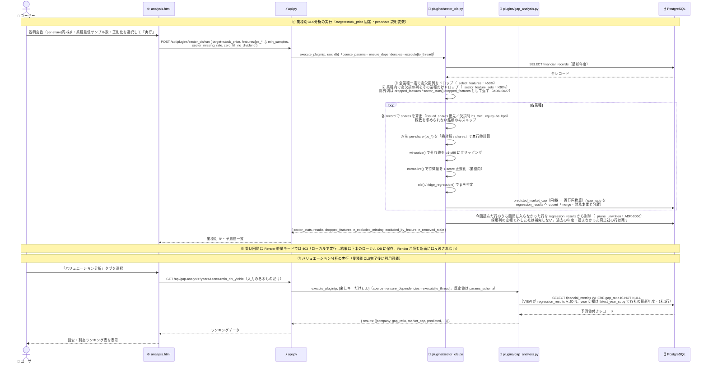

---

## 4-5. スクリーニングフロー

> 財務条件を指定して条件に合う銘柄を絞り込むフローです。

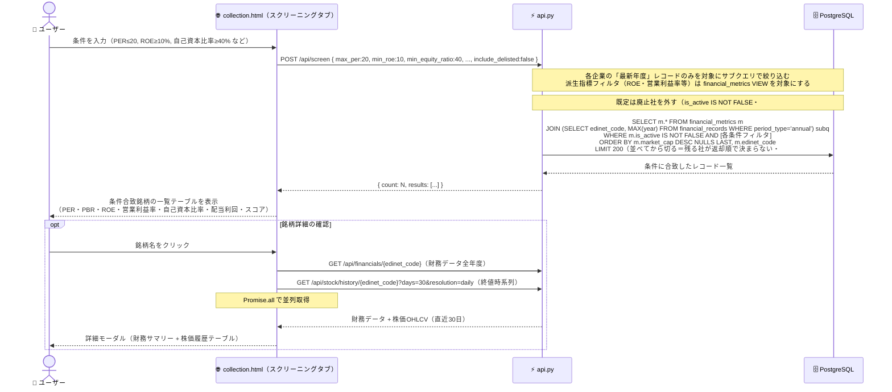

---

## 4-6. Zスコア正規化（financial_metrics VIEW で都度算出）

> 年度ごとに業界内での相対位置（偏差値に近い概念）を計算する。**事前計算・永続化は廃止**し、
> `financial_metrics` VIEW が読み取り時に SQL の window function で都度算出する（関数型）。

**VIEW 内の算出ロジック**（旧 `_calc_zscore_for_year` と同一・年度をまたがない）:
- 対象指標（`pl_revenue`, `op_margin`, `roe`, `equity_ratio`, `cf_ratio`, `pl_eps`, `de_ratio`, `nc_ratio`）ごとに
  `Z = (値 − AVG(値) OVER (PARTITION BY year)) / COALESCE(NULLIF(STDDEV_SAMP(値) OVER (PARTITION BY year), 0), 1.0)`
- 年度内の非NULL件数が 2 未満なら NULL（`COUNT(値) OVER (PARTITION BY year) >= 2` ガード）
- 標本標準偏差・`sd=0→1.0` フォールバック・丸め桁（z は 4 桁）まで旧実装に一致させてある。

> 旧 `calc_zscore_normalization` / `calc_growth_rates` / `_calc_zscore_for_year` 関数は削除済み（`database.py` の廃止の注記）。
> 派生比率・成長率も同様に VIEW が算出する（成長率は `LAG() OVER (PARTITION BY edinet_code ORDER BY year, period_end)`）。

---

## 4-7. エラー・キャンセルフロー

> 収集中にエラーが発生した場合、またはユーザーが停止ボタンを押した場合の挙動です。

| ケース | 発生条件 | 動作 |
|---|---|---|
| **① 手動停止** | ユーザーが「停止」ボタン | `POST /api/collect/stop` → `jobs.request_cancel("collection")` → BGT が次ループ先頭の `cancel_check()` で検出 → 処理済み分を `DB.commit()` → `collection_logs.status="done"` → `running=False` → SSE → UI 表示 |
| **② 1件単位エラー** | EDINET API / XBRL パースの例外 | `except` でスキップしてループ継続（`log.warning`）。収集自体は止まらない |
| **③ 重大エラー** | 予期しない例外でループ全体停止 | `collection_logs.status="error"`・`message=str(e)` → `running=False` → SSE → UI にエラー状態表示 |
| **④ ジョブスタック** | `finally` 未到達（強制終了等）で `running` フラグが残った | `POST /api/collect/reset-stuck`（または `smart-start { force:true }`）→ `jobs.state("collection").running=False`・DB の running ログを error 化 → 200 `{ reset_jobs: N }` |

---

## 5. 画面遷移図

> 各画面とその中のタブ構成、遷移ルートを示します。全サブページは共通の上部グローバルナビ（`.gnav`）を持つ（図の下の注記参照）。

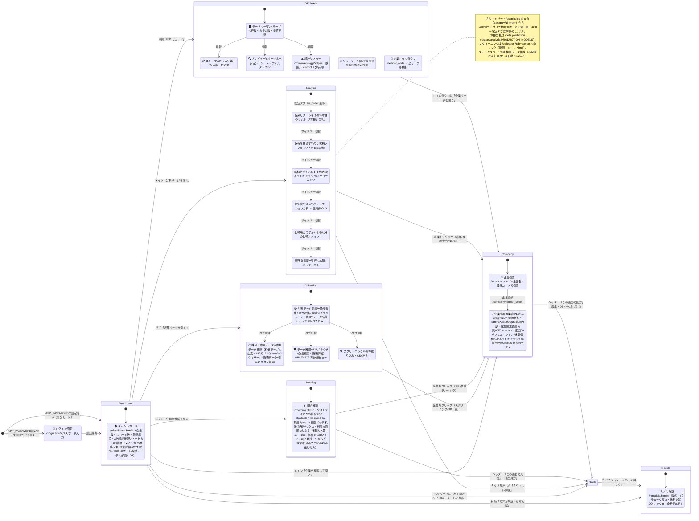

> **グローバルナビ（`.gnav`・全サブページ共通）**: ダッシュボード以外の全ページ（朝の推奨・分析・企業詳細・収集・DB・やさしい解説・モデル解説）の上部に、同一の横断ナビ `ホーム / 朝の推奨 / 分析 / 企業詳細 / 収集 ｜ やさしい解説 / モデル解説 / DB` を常設。主要5導線を左、リファレンス3件を右（`gnav-spacer` で右寄せ）に分け、現在ページは `.active`（下線）で示す。これにより「分析 → 気になった銘柄を企業詳細でドリルダウン」のような横移動がホーム経由なしで可能。収集ページのみ、この下にページ内タブ（財務データ収集 / 株価・市場 / データ確認 / スクリーニング）を別バーで持つ。`/db` は以前 gnav の項目に無く、開いても現在地が光らなかったので、#851 でリファレンス側へ足した。
>
> **この注記は7ファイルへのコピペで実装されている**（Jinja の `extends`/`include` は使っていない＝テンプレートは `FileResponse` で素の HTML を返す）。そのため「画面を足したがナビを貼り忘れた」「HTML は貼ったが `.gnav` の CSS を貼り忘れた」「色指定だけズレた」はどれも失敗として現れない——実際に `/morning` は入口（ダッシュボードのカード）だけあって出口の無い袋小路になり、「やさしい解説」のリンク色は `models`/`guide` だけ緑・他4ファイルは青にズレていた（`--val-up` は値の騰落色であって文字色ではない。`--status-good-text` へ統一）。`tests/test_templates_nav.py` が `templates/*.html` を全件分類した上で、`.active` の位置以外の差分を CI で落とす。
>
> **アクセシビリティの下限（#850）**: 補足文字 `--text-muted` は両テーマの `--bg` / `--bg-elevated` / `--bg-sunken` / `--bg-hover` に対して WCAG AA（4.5:1）以上、フォーカスは `outline:none` で消さず全画面共通の `:focus-visible`（`--accent-text` の 2px 枠。`--accent` はダークのカード上で 2.93:1 と非テキストの 3:1 に届かない）に任せる、文字は 11px 未満にしない、用語ツールチップ `.gloss` は `tabindex="0"` を持ちフォーカスでも開く、`showNotif` を呼ぶ画面はトーストの CSS（`.notif-stack` 等）を持つ（#850 まで一度も無く、エラーはページ最下部に装飾なしで足されて 4 秒で消えていた。エラーは閉じるまで残し、成功だけ 4 秒で消す）。どれも破っても画面は壊れないので、`tests/test_templates_a11y.py` が CI で照合する。企業詳細の検索は combobox（↑↓で候補・Enter で開く・遅れて届いた古い語の結果は捨てる）、タブは `aria-selected` と ←→/Home/End を持つ。

---

## 6. データ変換フロー（財務データが分析結果になるまで）

> XBRLデータが割安銘柄ランキングになるまでの変換過程を示します。

```mermaid
flowchart TD
    A["📋 EDINET\nXBRL書類（ZIP）\n有価証券報告書"]

    B["🔄 XBRLパース\nparse_xbrl_csv()\n─────────────────\nCSV内の要素名をXBRL_MAPで照合\n連結優先（NonConsolidated除外）\n前期比較データ除外（Prior含む行）"]

    C["📦 データ分類\n─────────────────\nBS: 総資産・純資産・現金など\nPL: 売上高・営業利益・純利益・EPSなど\nCF: 営業CF・投資CF・財務CFなど"]

    E["🗄️ DB保存（ソースのみ）\nupsert_financial()\n─────────────────\n(edinet_code, year, period_end)\nで重複チェック → 存在すれば更新\n※派生指標は保存しない（derived 取り込み廃止）"]

    F["📈 株価取得\nYahoo / J-Quants\n─────────────────\nstock_price/market_cap/per/pbr を\n収集時点スナップショットとして保存"]

    D["🧮 派生指標（永続化しない）\nfinancial_metrics VIEW\n─────────────────\nROE・営業利益率・自己資本比率・D/E・CF比率\nネットキャッシュ・各Zスコア・前期比成長率を\nソース列から都度SQL算出（関数型）"]

    I["🧩 業種別OLS分析（重い・ローカル実行）\nplugins/sector_ols.py\n─────────────────\n業種ごとに個別OLS／winsorize/z-score前処理\n→ predicted/gap を regression_results へ保存\n（Render軽量モードでは403）"]

    J["🎯 バリュエーション分析\nplugins/gap_analysis.py\n─────────────────\nfinancial_metrics VIEW（regression_results JOIN）から\ngap_ratio を読み取り→割安度/AR(1)半減期/期待総リターン"]

    K["🏆 割安銘柄ランキング\nanalysis.html\n─────────────────\n乖離率の小さい順に表示\n収束スコア・半減期は参考値として表示"]

    A --> B --> C --> E --> F --> D --> I --> J --> K

    style A  fill:#1e3a5f,color:#93c5fd
    style E  fill:#052e16,color:#86efac
    style D  fill:#1c1400,color:#fcd34d
    style K  fill:#2e1065,color:#c4b5fd
```

---

## 7. プラグインシステム（クラス図）

> 分析機能を差し込み式（プラグイン）で拡張できる構造を示します。

```mermaid
classDiagram
    class AnalysisPlugin {
        <<abstract>>
        +str name
        +str label
        +str description
        +list depends_on
        +bool heavy
        +str category
        +int ui_order
        +params_schema() dict
        +execute(params, db) dict
        +to_meta() dict
    }

    class GapAnalysisPlugin {
        +name = "gap_analysis"
        +label = "バリュエーション分析"
        +depends_on = ["sector_ols"]
        +params_schema() 年度・ソート順・最低配当利回り
        +execute() gap_ratio→割安度/半減期/期待総リターン
    }

    class RecommendPlugin {
        +name = "recommend"
        +label = "おすすめ銘柄"
        +depends_on = []
        +params_schema() プリセット選択・指標ウェイト
        +execute() 複合スコアでランキング生成
    }

    class SectorOLSPlugin {
        +name = "sector_ols"
        +label = "業種別OLS"
        +depends_on = []
        +heavy = True
        +params_schema() 業種選択・説明変数
        +execute() 業種内OLS→regression_results へ保存
    }

    class NetCashAnalysisPlugin {
        +name = "net_cash_analysis"
        +label = "ネットキャッシュ分析"
        +depends_on = []
        +params_schema() NC比率下限/上限・NCAV比率・営業CF/純利益フィルタ・時価総額・業種・年度
        +execute() 清原式NC比率＋グレアムNCAV比率でランキング生成（OLS不使用・品質ガード/トラップ除外付き）
    }

    class MacroRiskReturnPlugin {
        +name = "macro_risk_return"
        +label = "線形回帰（M-1）"
        +depends_on = []
        +heavy = True
        +params_schema() lambda_risk/risk_axis/fin_features(価格フリー含む)/use_macro(既定OFF・#615)/macro_features(multiselect・選択肢と既定の正本は macro_snapshots の MACRO_FEATURE_OPTIONS / DEFAULT_MACRO_FEATURES)/top_n 等
        +execute() 交差項OLS(財務×マクロ)+LassoLarsIC(BIC)選択+OLS再フィット+Walk-forward CV+James-Stein縮小。全社raw+selected_features+feature_coefs(標準化係数)を返却(効用U/Pareto/top_nはJS後処理)
    }

    class MacroEnetPlugin {
        +name = "macro_enet"
        +label = "正則化線形（M-6）"
        +depends_on = []
        +heavy = True
        +params_schema() fin_features/use_macro/macro_features/use_momentum/price_features 等（α・l1_ratio は fold 内で選ぶ）
        +execute() ElasticNet（build_interactions=False）で μ̂ 推定 → macro_enet_scores へ保存（売りの画面の参考表示と、S2 が使えない回の並び）。同じパネルで S2（下側20%点）も解き sell_quantile_scores へ（#1202・売りの並びの既定のキー・ADR-0076）
    }

    class MacroGbdtRankPlugin {
        +name = "macro_gbdt_rank"
        +label = "ランク学習（M-5）"
        +heavy = True
        +hidden = True
        +execute() M-2 を継承し4フックのみ override（producer なし＝OOF 比較専用）
    }

    class PluginsInit {
        <<module plugins/__init__.py>>
        -dict _registry
        +_load() プラグインファイルを自動スキャン
        +get_plugin(name) AnalysisPlugin
        +list_plugins() list
        +ensure_dependencies(plugin, db) depends_on 強制
        +execute_plugin(plugin, raw, db) async・coerce→ensure→execute の単一入口（execute は asyncio.to_thread でオフロード・実行中は any_executing()=True）
    }

    class Utils {
        <<module plugins/utils.py>>
        +coerce_params(schema, raw) typed params : パラメータ契約の coerce seam
        +ols(X, y) coefficients, r2
        +normalize(values, method) normalized_values
        +winsorize(values, p_low, p_high) clipped_values
        +walk_forward_cv_monthly(...) cv_metrics
        +fit_feature_columns(X, n_feat) win_params, norm_params
        +transform_feature_row(sample, win_params, norm_params) list
    }

    AnalysisPlugin <|-- GapAnalysisPlugin
    AnalysisPlugin <|-- RecommendPlugin
    AnalysisPlugin <|-- SellRankingPlugin
    AnalysisPlugin <|-- SectorOLSPlugin
    AnalysisPlugin <|-- NetCashAnalysisPlugin
    AnalysisPlugin <|-- MacroRiskReturnPlugin
    AnalysisPlugin <|-- MacroGbdtPlugin
    AnalysisPlugin <|-- MacroDlmPlugin
    AnalysisPlugin <|-- MacroEnsemblePlugin
    AnalysisPlugin <|-- MacroEnetPlugin
    MacroGbdtPlugin <|-- MacroGbdtRankPlugin

    PluginsInit --> AnalysisPlugin : 管理・呼び出し

    GapAnalysisPlugin     --> Utils : 統計処理を使用
    SectorOLSPlugin       --> Utils : ols() / winsorize() / normalize() を使用
    MacroRiskReturnPlugin --> Utils : ols() / winsorize() / walk_forward_cv_monthly(return_residuals) / get_macro_features() を使用

    note for SectorOLSPlugin "heavy=True: Render 軽量モードでは\nrun_plugin が 403 を返しローカル実行を促す\n（結果は regression_results に保存され本番へ反映）"
    note for GapAnalysisPlugin "業種別OLSの実行後でないと\nregression_results が空のため結果が出ない\n（financial_metrics VIEW 経由で gap_ratio を読む）"
    note for NetCashAnalysisPlugin "清原達郎『わが投資術』式\nNC = 流動資産 + 投資有価証券×0.7 − 総負債\nOLS不使用・会計値からの直接計算"
    note for MacroRiskReturnPlugin "財務OLS+LassoLarsIC(BIC)選択+OLS再フィット+walk-forward CV+James-Stein縮小（μ 側のマクロ・交差項は use_macro で足せるが既定 OFF・#615。マクロ起因リスク r_macro は横軸として残る）\nリスク軸 R1/R2/R3 を risk_axis で切替（効用U/Pareto/top_nはクライアント側後処理＝即時切替）\n期待リターン基準は μ_raw（μ_shrunk は低シグナル時に全社セクター平均へ潰れるため表の参考列のみ）。散布図は全社描画＋効用上位N強調・両軸[p1,p99]固定（効用上位Nのみだとリスク方向に潰れるため）。軸外れ値は三角マーカーで端に境界表示・フロンティア線は実値描画（chartArea で切断）・対数X軸トグルあり（M-1/M-2/M-3/M-6共通・analysis.js の _mrrGeom/_mrrLogAxisRange。M-2 と M-6 は描画一式を共通ビュー _riskReturnView で共有・#807）\n（R3=セクター×サイズ別バケットの CV 残差 RMSE・サイズ代理 bs_total_assets）\nマクロ計算は日付メモ化で高速化（既定219s→29s）\nheavy=True / use_macro=False で純財務モデルにも縮退"
    note for MacroEnetPlugin "ADR-0021 の bake-off で M-2 に有意優位＝正式兄弟へ昇格\nproducer = macro_enet_scores・同じ実行で売りの並びのキー S2（sell_quantile_scores）も作る（ADR-0076）
画面は M-2 と同じ散布図で縦軸は相対 μ̂（mu_rel＝今買える社の中央値との差・水準は未検証）・λ 既定 0・行クリックで線形の内訳（合計＝μ̂）・#807"
    note for MacroGbdtRankPlugin "退役＝hidden=True（#570・ADR-0044）\n実測で M-2 に有意劣後（ADR-0017 の実測節）\nサイドバーから除外・実行経路と比較行は残す"
    note for MacroEnsemblePlugin "退役＝hidden=True（#570・ADR-0044）\n統合が M-6 単体を上回らない（ADR-0044）\nサイドバーと mu_source から除外・実行経路と比較行は残す"
    note for AnalysisPlugin "params_schema() はパラメータ契約（CONTEXT.md）:\ntype=ウィジェット / dtype=データ型 の2軸。\nexecute は coerce 済み typed params を受け取り、\n意味的 validation だけ持つ（型変換・default・\nbounds/membership は coerce_params が担う）"
    note for Utils "統計は numpy / scipy / statsmodels / sklearn を使用。\ncoerce_params（パラメータ契約の coerce seam）と\nwalk_forward_cv_monthly() を含む"
```

---

## 8. REST API エンドポイント一覧

> このツールが提供する全APIエンドポイントの一覧です。

```mermaid
graph LR
    subgraph PAGE["📄 ページ配信"]
        P1["GET /\ndashboard.html を返す"]
        P1m["GET /morning\nmorning.html を返す\n（朝の推奨・読むだけ）"]
        P2["GET /collection\ncollection.html を返す"]
        P3["GET /analysis\nanalysis.html を返す"]
        P4["GET /login\nlogin.html を返す"]
        P5["GET /models\nmodels.html を返す\n（モデル解説・参考文献）"]
        P5g["GET /guide\nguide.html を返す\n（初心者向けやさしい解説）"]
        P6["GET /db\ndb.html を返す\n（DBビューア）"]
        P7["GET /company\ncompany.html を返す\n（企業検索）"]
        P8["GET /company/{edinet_code}\ncompany.html を返す\n（個別企業の業績・財務・CF可視化）"]
    end

    subgraph OPS["🩺 運用"]
        H1["GET /health\n死活監視（DB疎通確認、認証不要）\n200=ok / 503=degraded"]
        H2["GET /api/system/info\nwrites_blocked（RENDER_LIGHT_MODE または接続先 prod）＋接続先(db_target/db_is_local/db_label)を返す\n（analysis.js が heavy プラグイン可否を判定／collection.js が書き込み系ボタンを無効化・#733／common.js がローカル接続バッジを出す・#481）"]
        H3["POST /heartbeat\nブラウザ生存通知（認証不要・common.js が5秒毎送信）\nFINAPP_AUTO_SHUTDOWN=1（launch.py 経由）時のみ\n途絶30秒で自動停止。収集ジョブ実行中は保留"]
    end

    subgraph AUTH["🔐 認証 /api/auth/"]
        A1["POST /api/auth/login\nパスワード認証 → HttpOnly Cookie + CSRF Cookie 発行"]
        A2["POST /api/auth/reset-password\n回復キーでパスワード変更"]
        A3["GET /api/auth/status\n認証が必要かどうかを返す"]
        A4["POST /api/auth/logout\n認証Cookieを削除"]
    end

    subgraph STATS["📊 統計 /api/stats"]
        S1["GET /api/stats\n企業数・レコード数・最新年度\n+ データ鮮度（最終更新日時・経過日数・期待最新年度・freshness判定）\n+ 株価 as-of 分位（p50/p05/max・stale_bdays・n_stale_over_5d・price_freshness）#416
+ batch（夜間/月次/watchdog の足跡・batch_freshness.summarize と共有）#563"]
        S2["GET /api/companies\n企業一覧（検索・業種・市場フィルタ・active_only）。limit は 1〜500（#254）"]
        S7["GET /api/industries\n業種一覧（companies.industry の重複なし・空欄除外・廃止社も含む）。\n業種プルダウン用（#803。全社を取って集めると limit 上限で 400 になっていた）"]
        S6["GET /api/peers?industry&code&top\n同業比較（#801）。業種内の上場中で通期の財務を持つ社を\n時価総額順に全件で並べ、上位 top 社＋code の社と total・rank を返す\n（廃止社の code は rank=null）"]
        S3["GET /api/financials/{edinet_code}\n指定企業の全年度財務データ\n+ TOPIX 移行措置・新規採用の事実と日程（index_event / index_events）#1013"]
        S4["GET /api/stock/history/{edinet_code}?resolution=daily|weekly\n終値時系列（close-only・daily=直近6か月/weekly=全履歴）"]
        S5["GET /api/export/csv\n財務データをCSVでダウンロード"]
    end

    subgraph COLLECT["📦 収集管理 /api/collect/（GET 以外は閲覧専用の環境で一律 403・ルーター依存・#733）"]
        C1["POST /api/collect/start\n財務データ収集を開始"]
        C2["POST /api/collect/stop\n財務データ収集を停止"]
        C3["GET /api/collect/stream\nSSE: 収集進捗をリアルタイム配信"]
        C4["GET /api/collect/status\n直近ジョブの状態確認"]
        C5["POST /api/collect/refresh/{edinet_code}\n1社だけ再取得"]
        C6["POST /api/collect/market-data\n株価データ更新を開始"]
        C7["POST /api/collect/market-stop\n株価更新を停止"]
        C8["GET /api/collect/market-stream\nSSE: 株価更新進捗"]
        C9["GET /api/collect/market-data/status\n株価更新の状態"]
        C14["GET /api/collect/history/coverage\n収集済み社数・レコード数"]
        C14b["POST /api/collect/jquants/start\nJ-Quants日次データ収集（上書き更新）"]
        C14c["POST /api/collect/jquants/stop\nJ-Quants収集を停止"]
        C14d["GET /api/collect/jquants/stream\nSSE: J-Quants収集進捗"]
        C14e["GET /api/collect/jquants/status\nJ-Quants収集の状態"]
        C15["GET /api/collect/edinet-coverage\nEDINET収録状況"]
        C16["GET /api/collect/market-coverage\n株価データ収録状況"]
        C17["GET /api/collect/data-quality\nNULL率・外れ値チェック\n会計基準別サマリ（JGAAP/IFRS/US-GAAP）"]
        C18["POST /api/collect/industry\nJPX Excelから業種データを更新\n→ 空欄を EDINET コードリストで補完"]
        C19["POST /api/collect/macro/start\nマクロデータ収集（為替・金利・指数・コモディティ）"]
        C20["POST /api/collect/macro/stop\nマクロ収集を停止"]
        C21["GET /api/collect/macro/status\nマクロ収集の状態"]
        C22["GET /api/collect/macro/stream\nSSE: マクロ収集進捗"]
        C23["POST /api/collect/reparse/start\nxbrl_raw_documentsから再解析（EDINET通信なし）\nRender可・年度/EDINETコードフィルタ対応"]
        C24["POST /api/collect/reparse/cancel\n再解析を停止"]
        C25["GET /api/collect/reparse/stream\nSSE: 再解析進捗"]
        C26["POST /api/collect/smart-start\nスマート収集（DB状態から自動判定）"]
        C27["POST /api/collect/reset-stuck\nスタックしたrunningジョブを強制リセット"]
    end

    subgraph MACRO["🌐 マクロデータ /api/macro/"]
        MA1["GET /api/macro/series\n系列カバレッジ一覧（件数・最古日・最新日）"]
        MA2["GET /api/macro/data/{series_code}\n指定系列の日次データ（OHLCV）"]
    end

    subgraph SCHED["🖱️ 手動差分収集 /api/scheduler/"]
        SC3["POST /api/scheduler/run-now\n財務の差分収集を手動実行\n（過去1年・skip_existing・株価/マクロは更新しない）"]
    end

    subgraph ANALYSIS["📊 分析 /api/"]
        AN1["GET /api/plugins\nプラグイン + 特例エントリ(screen/backtest/model_comparison)のメタ一覧\n（category/ui_order/heavy/hidden/production 含む・ui_order 昇順）\n退役（hidden=True・ADR-0044）は除外"]
        AN2["POST /api/plugins/{name}/run?persist=\nプラグインを実行\n（heavy かつ writes_blocked＝RENDER_LIGHT_MODE または接続先 prod は 403・#733）\nheavy はローカルバッチ実行中・同じ heavy が実行中なら 409\nheavy は実行中の進捗を JobState へ流す（#545）\nheavy は既定で保存しない（tuning_dry_run）。保存は persist=1 のときだけ（ADR-0072）"]
        AN14["GET /api/batch/activity\nいま走っているローカルバッチ（running）と\n期限切れで残った実行中マーカー（stale）\n分析画面が heavy のボタンを止める帯に使う"]
        AN15["GET /api/plugins/{name}/preflight\nheavy を押す直前の確認材料\n（blocked_reason / writes / writes_impact / last_run_min）"]
        AN16["GET /api/plugins/{name}/saved?limit=\nheavy のタブを開いたときの保存済みの結果（読取専用・ADR-0072）\nM-2/M-3/M-6 は μ̂ 上位（今買える社）・sector_ols は計算時刻と社数・M-1/モデル比較は saved=false\nsector_ols と M-6 は diagnostics＝夜間の診断値の最新1行の要約（OOF の rank-IC・売り側spread／業種別 R²・#1178）"]
        AN12["GET /api/plugins/{name}/progress\nheavy プラグイン実行の進捗 SSE（#545）\n{running, progress, total, new_logs}\n画面は POST の応答を待たずに開く\n（POST が完了まで返らないため）"]
        AN16["POST /api/plugins/{name}/cancel\n画面から回した heavy の取消（協調型・#849）\n{accepted, running, saving, message}\n次の進捗の区切りで止まり、実行は 409\n保存を始めた後は受け付けない（DB へは書かない）"]
        AN11["GET /api/plugins/{name}/tuned\n自動調整済みハイパーパラメータ\n（hyperparameter_search.py --persist が書込・未調整は404）\n読取専用・軽量。探索自体はローカル月次バッチ経由\nparams は現在の探索空間へ射影して返す(#604)\n生値=params_as_tuned・変えたキー=stale_params\n測ったパネルの照合=panel_changed(#711)\nFalse と言えたときだけ画面が自動プリフィル"]
        AN10["GET /api/model/status\n業種別OLSモデルの鮮度情報\n（computed_at/staleness_days/n_results/is_stale）\n鮮度バーUI用の軽量GET"]
        AN4["GET /api/gap-analysis?year=&sort=&min_div_yield=\nバリュエーション分析（旧互換エンドポイント・year 空欄=各社の最新）"]
        AN5["POST /api/screen\nスクリーニング（条件絞り込み）"]
        AN6["GET /api/recommend/presets\n推薦プリセット一覧"]
        AN7["POST /api/recommend\n推薦スクリーニング実行\nweights.mu は opt-in（mu_source 必須・未指定は400）\n既定プリセットは mu 重みを持たない＝既定は μ̂ 不使用"]
        AN8["GET /api/backtest\n過去スコアリングの実績リターン検証\n?preset&months_ago&top_n&source&cost_bps / summary+percentiles（*_net併記）\n財務は決算日が開始日 − FINANCIAL_LAG_DAYS 以前の行だけ（未公表の決算を読まない・financial_cutoff を返す）\n時価総額・配当利回り・gap_ratio は開始日の株価で作り直す（#1248・asof_valuation / asof_gap を返す）\nmu を含む重みは400（as-of再現不能・ADR-0030）"]
        AN9["GET /api/backtest/multi\n複数保有期間（3/6/12/18/24ヶ月）一括比較\n?preset&top_n&source&cost_bps"]
        AN17["POST /api/backtest/model-comparison\n将来リターン予測 M-1/M-2/M-3/M-4/M-5/M-6 の OOF 横並び比較\n（各モデルの oof_backtest を集約・as-of上位Nとは別手法）\n6モデルとも heavy＝ローカル専用（Renderは各モデルskip）"]
        AN13["GET /api/morning\n朝の推奨（読むだけ・学習も再計算もしない）\n?preset&top_n&mu_source / recommend + 鮮度ブロック\n（price/gap_ratio/mu/macro/batch/overall_verdict/tradable/reasons）\n赤でもランキングは返し発注非推奨だけ明示する"]
    end

    subgraph PF["💼 売買の記録 /api/portfolio/"]
        PF1["GET /api/portfolio/ledger\n記録の一覧（新しい順・取り消された行は voided=true）"]
        PF2["GET /api/portfolio/summary\n保有・実現/評価損益・週次の時間加重リターン・対 TOPIX・最大下落\n分割の行の抜けの警告（読むだけ）"]
        PF5["GET /api/portfolio/sell-candidates
記録の保有を売り候補ランキングにかけた結果（朝の画面用）
保有なし・判定できないときは ranking=null と理由（読むだけ）"]
        PF3["POST /api/portfolio/ledger\n買い・売り・分割を1行追記\n（収集ルーター配下＝閲覧専用の環境では 403）"]
        PF4["POST /api/portfolio/ledger/{id}/void\n取消の行を追記（元の行は消さない）"]
    end

    subgraph DBV["🗃️ DBビューア /api/db/"]
        DB1["GET /api/db/tables\n全テーブルの行数・カラム数・最終更新"]
        DB2["GET /api/db/schema/{table}\nカラム定義・NULL率・PK/FK"]
        DB3["GET /api/db/preview/{table}\n行プレビュー（ページネーション・ソート・フィルタ）"]
        DB4["GET /api/db/stats/{table}\n統計サマリー（min/max/avg/p50/p99/distinct）"]
        DB5["GET /api/db/relations\nテーブル間FKリレーション一覧"]
        DB6["GET /api/db/company/{edinet_code}\n企業別ドリルダウン（全テーブル横断）"]
        DB7["GET /api/db/export/{table}\nテーブルをCSVでダウンロード（フィルタ対応）"]
    end
```

---

## 9. デプロイ構成図

> **Render 側の構成**: Render（Web Service）+ Supabase（PostgreSQL の断面）。Render は `FINAPP_DB_TARGET=prod` で Supabase の断面（2026-08-07 時点）を読む**閲覧専用の窓**で、正本（ローカル PostgreSQL）とそれを更新するバッチは §1 の図にある（#503・[ADR-0038](adr/0038-local-postgres-is-the-primary.md)）。
> 詳細な運用ガイドは [docs/DEPLOYMENT.md](DEPLOYMENT.md) を参照。

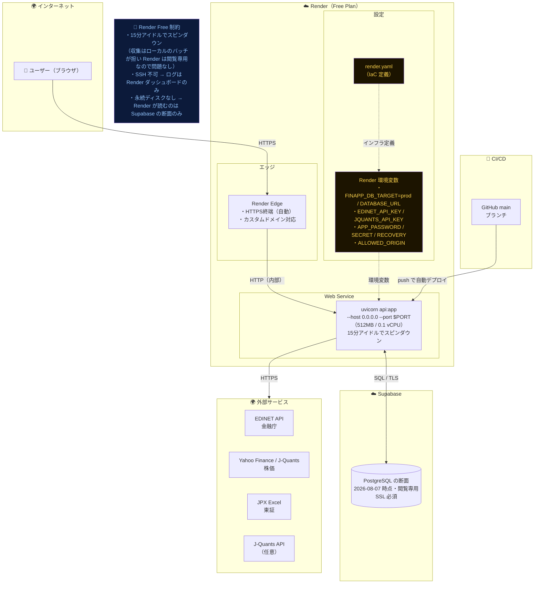

---

## 10. ファイル役割一覧

> `plugins/` 配下は本表では1行要約に留め、**内部契約・producer 契約・パラメータ・実測値は [PLUGIN_REFERENCE.md](PLUGIN_REFERENCE.md) が正本**（本表のセルが 500〜600 字まで肥大し索引として読めなくなっていたため分離）。モデルの理論・数式は [MODELS.md](MODELS.md)。
>
> `scripts/` 配下とリポジトリ直下の起動用 `*.ps1` も同じく1行要約に留め、**役割の詳細・内部仕様・実測値は [SCRIPTS_REFERENCE.md](SCRIPTS_REFERENCE.md) が正本**（#843。1セルが 1,000〜3,000 字まで育っていた）。スクリプトを足したら、あちらへ節を1つ、本表へリンク付きの1行を足す。
>
> それ以外（リポジトリ直下のモジュール・画面・`tests/`・`.github/workflows/`）も役割は1〜2文に留め、**詳しい説明は [MODULE_REFERENCE.md](MODULE_REFERENCE.md) が正本**（#1293。セルが 2,500 字まで育っていた）。ファイルを足したら本表へ1行を足し、詳しく書くことがあればあちらへ節を足して行からリンクする。

| ファイル | 種別 | 役割 | 主な依存先 |
|---|---|---|---|
| `api.py` | バックエンド | FastAPI アプリ本体。REST ルートは `routers/` 6本へ分割し `include_router` で集約。自身は HTML ページ配信・`/api/system/info`・`/heartbeat`・ミドルウェア（認証/CORS）・`StaticFiles` マウントを担う（`/health` は `routers/auth.py`）。収集ジョブの実行時状態は `collection_jobs.jobs` registry、バックテスト計算は `backtest`、財務レコード整形は `serializers` へ委譲 | routers/*, database.py, collector.py, collection_jobs.py, backtest.py, serializers.py, plugins/ |
| `routers/*.py` | バックエンド | `api.py` が `include_router` で束ねる REST ルーター6本（`auth` / `collect` / `portfolio` / `market` / `analysis` / `morning`）。書くルートは `routers/collect.py` に置く。[詳細](MODULE_REFERENCE.md#routerspy) | database.py, collection_jobs.py, plugins/, data_quality.py |
| `collection_jobs.py` | バックエンド | 収集ジョブなどのバックグラウンドジョブの実行時状態（進捗・ログ・キャンセル）を job 名キーで持つ registry と、その SSE 配信。[詳細](MODULE_REFERENCE.md#collection_jobspy) | fastapi |
| `backtest.py` | バックエンド | バックテスト（スコア上位 N 社の実績リターン）。株価を使う列を開始日の株価で作り直し、開始日に買えた社へ絞る。[詳細](MODULE_REFERENCE.md#backtestpy) | database.py, plugins.recommend, plugins.net_cash_analysis |
| `model_comparison.py` | バックエンド | M-1〜M-6 の OOF バックテストを横並びに集約する（`POST /api/backtest/model-comparison`）。進捗はモデル単位で出す。[詳細](MODULE_REFERENCE.md#model_comparisonpy) | plugins/, model_stats.py |
| `model_stats.py` | バックエンド | モデル比較の統計後処理（rank-IC 差のブートストラップ検定・分位単調性の要約・多重比較の補正）。[詳細](MODULE_REFERENCE.md#model_statspy) | — |
| `serializers.py` | バックエンド | 財務レコード（`FinancialMetric`）を bs/pl/cf/val/nc/nonfin/zscore のネスト dict へ整形する純粋関数 `record_to_dict`。画面（`static/js`）が読むキーは全て出すこと（`tests/test_serializers.py` が照合・#928） | — |
| `database.py` | バックエンド | テーブル定義・upsert と、派生指標を都度算出する VIEW（`financial_metrics` ほか）の定義。表の一覧は §3。[詳細](MODULE_REFERENCE.md#databasepy) | PostgreSQL |
| `db_egress.py` | バックエンド | Egress 台帳とサーキットブレーカ（ADR-0034/0037）。全プロセスの読み出し量を記録し、プロセス予算と請求サイクル累計の2軸で止める。[詳細](MODULE_REFERENCE.md#db_egresspy) | sqlalchemy.event |
| `weekly_price_cache.py` | バックエンド | 週次株価の run 間差分ロードキャッシュ（ADR-0036）。速さだけを担い、指紋・世代印・行数のどれかが外れたらフルロードへ倒す。[詳細](MODULE_REFERENCE.md#weekly_price_cachepy) | database（遅延 import のみ） |
| `corporate_actions.py` | バックエンド | 企業イベント台帳（ADR-0062）。分割・併合・スピンオフの登録表と分割補正係数 F の検出器の唯一の源で、F の表と TTM へ同じものを渡す。[詳細](MODULE_REFERENCE.md#corporate_actionspy) | database.py |
| `index_event_study.py` | バックエンド | 指数イベントのイベントスタディの部品。事前登録 `docs/prereg/index-event-2026.md` の測り方を純関数にしたもの。[詳細](MODULE_REFERENCE.md#index_event_studypy) | numpy, pandas（database・scripts は import しない・テストで固定） |
| `index_event_notes.py` | バックエンド | 推奨・売り・企業詳細の応答へ、TOPIX の移行措置・新規採用の印と注記を付ける。[詳細](MODULE_REFERENCE.md#index_event_notespy) | index_events.py |
| `portfolio_ledger.py` | バックエンド | 売買の記録（`trade_ledger`）から保有・損益・対 TOPIX の期間リターンを導出する（#1222）。記録は追記のみ。[詳細](MODULE_REFERENCE.md#portfolio_ledgerpy) | database.py（遅延 import） |
| `index_events.py` | バックエンド | 指数イベント台帳（ADR-0068）。TOPIX の移行措置・新規採用を公表日 as-of で時点再現する。[詳細](MODULE_REFERENCE.md#index_eventspy) | 標準ライブラリのみ（I/O は database・panel は pandas を遅延 import） |
| `ttm_composite.py` | バックエンド | TTM 行（直近12か月）の合成（ADR-0051）。夜間に `ttm_financial_records` を全置換する。[詳細](MODULE_REFERENCE.md#ttm_compositepy) | corporate_actions.py, database.py, collector_prices.py |
| `sysmem.py` | バックエンド | プロセスツリーの常駐メモリと物理メモリの実測の唯一の源（Windows は ctypes・Linux は `/proc`）。[詳細](MODULE_REFERENCE.md#sysmempy) | （標準ライブラリのみ） |
| `jax_import_guard.py` | バックエンド | Smart App Control が GPU 専用の jaxlib 拡張を遮断しても、CPU の jax を立ち上げる import ガード。[詳細](MODULE_REFERENCE.md#jax_import_guardpy) | （標準ライブラリのみ） |
| `collector.py` | バックエンド | **オーケストレータ＋後方互換の再エクスポート層**。CLI エントリ（`python collector.py ...`）を保持し、責務別5モジュールの全シンボルと `collector_interim.run_interim_collection` を再エクスポートする（`from collector import X` / `collector.X` は従来どおり）。実体は下記6ファイル | collector_utils/master/financials/prices/disclosures/interim |
| `collector_utils.py` | バックエンド | 収集系共通の設定定数・ロガー・丸め許容 `rounding_tolerance`・例外文字列から API キーを消す `redact_secrets`。[詳細](MODULE_REFERENCE.md#collector_utilspy) | dotenv |
| `collector_master.py` | バックエンド | 企業・業種マスタの収集（EDINET の書類一覧の走査・JPX の業種と上場銘柄一覧の月次断面）。[詳細](MODULE_REFERENCE.md#collector_masterpy) | EDINET API, EDINET コードリスト, JPX, collector_utils |
| `collector_financials.py` | バックエンド | XBRL 財務収集・パース・正規化（`parse_xbrl_csv` / `calc_derived` ほか）＋ CF/PL-BS 補完・再解析＋全件収集オーケストレーション（`run_full_collection` / `_phase_*`）。**派生指標・Zスコア・成長率・nc_ratio は永続化しない**（financial_metrics VIEW が担う）。`calc_derived` は free_cf/nonoperating_income の算出のみ残す | EDINET API, collector_utils, collector_master |
| `collector_prices.py` | バックエンド | 株価（Yahoo / J-Quants）・市場データ・マクロ系列の収集と、週次株価の段差の検出・修復。[詳細](MODULE_REFERENCE.md#collector_pricespy) | J-Quants, Yahoo, FRED, 日銀API, OECD API, ESRI, IMF API, e-Stat, collector_utils, corporate_actions |
| `tuning_cycle.py` | ユーティリティ | 日中枠で M-2 の探索を数日に分けて回し切る周回の状態と、段の移り変わり（ADR-0070）。[詳細](MODULE_REFERENCE.md#tuning_cyclepy) | hyperparameter_search.py, scripts/run_daytime.py, batch_freshness.py |
| `sector_gap_asof.py` | バックエンド | 学習パネルとバックテストの開始日が使う、時点再現の gap_ratio（ADR-0057）。`regression_results` へは書かない。[詳細](MODULE_REFERENCE.md#sector_gap_asofpy) | plugins/sector_ols.py, plugins/macro_snapshots.py, nightly_scores.py, database.py |
| `collector_disclosures.py` | バックエンド | 会社予想の開示（J-Quants `/fins/summary`）の収集。予想の中身は分析に使っていないが、株数と TTM の会計基準判定が読む。[詳細](MODULE_REFERENCE.md#collector_disclosurespy) | J-Quants, collector_utils, collector_prices, database.py |
| `collector_interim.py` | バックエンド | 半期（H1）財務の収集（`period_type='H1'`）。通期の収集とは独立している。[詳細](MODULE_REFERENCE.md#collector_interimpy) | EDINET API, collector_utils, collector_financials, database.py |
| `data_quality.py` | バックエンド | データ品質チェック（NULL率・外れ値・収録状況） | database.py, api.py（import元） |
| `plugins/base.py` | バックエンド | 分析プラグインの抽象基底クラス（`heavy`／`hidden`（退役＝`/api/plugins` から除外・ADR-0044）／`ui_order`／`produced_output`／`writes`（画面から実行したときに置き換わる保存済みの表。heavy は宣言必須で、書かないなら `()`。実行前の確認ダイアログに出す・`tests/test_batch_activity.py::TestHeavyDeclaresWrites`）の共通契約）。詳細は [PLUGIN_REFERENCE.md](PLUGIN_REFERENCE.md#pluginsbasepy) | — |
| `plugins/__init__.py` | バックエンド | プラグインを自動スキャン・レジストリ管理。`execute_plugin(plugin, raw, db)` が起動の単一入口。詳細は [PLUGIN_REFERENCE.md](PLUGIN_REFERENCE.md#plugins__init__py) | plugins/*.py |
| `plugins/gap_analysis.py` | バックエンド | バリュエーション分析（割安度＋AR(1)半減期＋期待総リターン）。`/api/gap-analysis` は後方互換で維持。詳細は [PLUGIN_REFERENCE.md](PLUGIN_REFERENCE.md#pluginsgap_analysispy) | plugins/utils.py |
| `plugins/recommend.py` | バックエンド | 複合スコアによる銘柄推薦。μ̂ は opt-in・既定 OFF（ADR-0030）で、VIEW 由来の指標は加重前に断面で winsorize→標準化する（#509）。詳細は [PLUGIN_REFERENCE.md](PLUGIN_REFERENCE.md#pluginsrecommendpy) | plugins/utils.py, database.py |
| `plugins/sell_ranking.py` | バックエンド | 売り候補ランキング。保有を売り専用の予測 S2 の昇順に並べ、下位 1/5 を `SELL` にする（ADR-0071・ADR-0076）。S2 が使えない回は M-6 の μ̂ で並べる。詳細は [PLUGIN_REFERENCE.md](PLUGIN_REFERENCE.md#pluginssell_rankingpy) | database.py, plugins.macro_enet, index_event_notes |
| `plugins/sector_ols.py` | バックエンド | 業種別OLS回帰分析（次元整合・winsorize+z-score 前処理）。予測値を `regression_results` へ保存・`heavy=True`。`_load_records` は `sector_load_fields(features)` の列だけを引き、`issued_shares` は `companies` と `COALESCE`（#482・#462 経路の温存）。詳細は [PLUGIN_REFERENCE.md](PLUGIN_REFERENCE.md#pluginssector_olspy) | plugins/utils.py |
| `plugins/net_cash_analysis.py` | バックエンド | ネットキャッシュ分析（清原式）＋グレアム NCAV。詳細は [PLUGIN_REFERENCE.md](PLUGIN_REFERENCE.md#pluginsnet_cash_analysispy) | database.py |
| `plugins/macro_snapshots.py` | バックエンド | M 系が共有するスナップショット構築基盤（プラグインではない・ADR-0003 §3）。週次株価は `weekly_price_cache` 経由の差分ロード。詳細は [PLUGIN_REFERENCE.md](PLUGIN_REFERENCE.md#pluginsmacro_snapshotspy) | plugins/utils.py, weekly_price_cache.py |
| `plugins/tuning.py` | バックエンド | M-1/M-2/M-3 共有ハイパーパラメータ自動探索エンジン（ADR-0007）。呼び出し元は CLI（`hyperparameter_search.py`）のみ（プラグインではない）。定期実行ではローカルの月次バッチ（`scripts/run_monthly.py` / `run_monthly_m1.py`）と日中枠（`scripts/run_daytime.py` の `tune:*`）がこの CLI を叩く。詳細は [PLUGIN_REFERENCE.md](PLUGIN_REFERENCE.md#pluginstuningpy) | plugins/utils.py, plugins/__init__.py, database.py |
| `plugins/macro_risk_return.py` | バックエンド | **M-1** マクロ×リスク-リターン推奨（財務OLS+BIC選択+Walk-forward CV。μ 側のマクロ・交差項は**既定 OFF**・#615）。producer＝共有 `macro_beta`・`heavy=True`。詳細は [PLUGIN_REFERENCE.md](PLUGIN_REFERENCE.md#pluginsmacro_risk_returnpy) | plugins/utils.py, macro_snapshots.py |
| `plugins/macro_gbdt.py` | バックエンド | **M-2** マクロ×財務 勾配ブースティング（ADR-0003/0004/0020）。producer＝`macro_gbdt_scores`（μ̂＋`r1_prime`）・`heavy=True`。詳細は [PLUGIN_REFERENCE.md](PLUGIN_REFERENCE.md#pluginsmacro_gbdtpy) | plugins/utils.py, macro_snapshots.py, xgboost, shap |
| `plugins/macro_dlm.py` | バックエンド | **M-3** ベイズ状態空間モデル（時変マクロβ DLM・週次・財務不使用）。producer＝`macro_dlm_scores`（`r1_prime` なし＝R3 ゲート無効）・`heavy=True`。詳細は [PLUGIN_REFERENCE.md](PLUGIN_REFERENCE.md#pluginsmacro_dlmpy) | numpy, scipy, plugins/utils.py |
| `plugins/macro_ensemble.py` | バックエンド | **M-4** 兄弟μ̂スタッキング（ADR-0015・基底 M-1+M-2+M-6 を `BASE_MODELS` 定数駆動・二段ウォークフォワード NNLS）。**退役＝`hidden=True`**（#570/ADR-0044・統合が M-6 単体を上回らない。サイドバーと `mu_source` から除外・実行経路と比較行は残す）。producer＝`macro_ensemble_scores`・`heavy=True`。詳細は [PLUGIN_REFERENCE.md](PLUGIN_REFERENCE.md#pluginsmacro_ensemblepy) | plugins/macro_snapshots.py, plugins/macro_gbdt.py, plugins/macro_risk_return.py, scipy, xgboost |
| `plugins/macro_gbdt_rank.py` | バックエンド | **M-5** マクロ×財務 ランク学習（ADR-0017・M-2 を継承し4フックのみ override）。**退役＝`hidden=True`**（#570/ADR-0044・実測で M-2 に有意劣後＝数値は ADR-0017 の実測節。サイドバーから除外・実行経路と比較行は残す）。**producer なし＝OOF 比較専用**・`heavy=True`。詳細は [PLUGIN_REFERENCE.md](PLUGIN_REFERENCE.md#pluginsmacro_gbdt_rankpy) | plugins/macro_gbdt.py, plugins/utils.py, xgboost, shap |
| `plugins/macro_enet.py` | バックエンド | **M-6** マクロ×財務の正則化線形（ElasticNet・ADR-0021）。producer＝`macro_enet_scores`・`heavy=True` で、同じパネルで売り専用の予測 S2 も解いて `sell_quantile_scores` へ保存する。詳細は [PLUGIN_REFERENCE.md](PLUGIN_REFERENCE.md#pluginsmacro_enetpy) | plugins/model_candidates.py, plugins/macro_snapshots.py, plugins/utils.py, scikit-learn |
| `plugins/model_candidates.py` | バックエンド | **兄弟モデル候補メニュー（探索枠・ADR-0021）**。`walk_forward_cv_monthly(fit_predict=…)` へ注入する候補ファクトリ集約。**プラグインではない**（レジストリ非登録・API 非公開）。詳細は [PLUGIN_REFERENCE.md](PLUGIN_REFERENCE.md#pluginsmodel_candidatespy) | plugins/utils.py, recommend_factor_premia.py, scikit-learn, (lightgbm/catboost 任意) |
| `plugins/utils.py` | バックエンド | `coerce_params()`・`ols()`・`normalize()`・`winsorize()`・`walk_forward_cv_monthly()`・`get_macro_features()` 等の共通ユーティリティ。ベクトル化後も旧実装とビット単位で同一値。`get_macro_features` は `macro_data` を3列指定で引く（`_preload_macro_impl` と同一・#482）。詳細は [PLUGIN_REFERENCE.md](PLUGIN_REFERENCE.md#pluginsutilspy) | — |
| `plugins/progress.py` | バックエンド | heavy な分析の実行進捗と画面からの取消を流す唯一の経路（#545・#849）。sink 未設定なら no-op で、`PROGRESS_COVERAGE` を `tests/test_plugin_progress.py` が実体と照合する。詳細は [PLUGIN_REFERENCE.md](PLUGIN_REFERENCE.md#pluginsprogresspy) | — |
| `tests/` | テスト | pytest の回帰テスト（件数は書き写さない）。文書の同期・リンクの実在などのメタ検査も含む。[詳細](MODULE_REFERENCE.md#tests) | pytest, sqlalchemy, fastapi, httpx |
| `tests/README.md` | テスト | テスト実行方法・fixture 方針の補足ドキュメント | — |
| `requirements-dev.txt` | 設定 | 開発・テスト専用依存（`pytest`）。本番 `requirements.txt` と分離（Render メモリ節約） | — |
| `requirements-optional.txt` | 設定 | ローカル探索専用の任意依存（`lightgbm`/`catboost`・#372）。**本番 `requirements.txt` には入れない**（Render 無料プランのビルド footprint を増やさない）。未導入でも `plugins/model_candidates.py` の該当候補が自動スキップされるだけでアプリは無影響。正式採用（本番コードパスで必須化）へ昇格した時点で `requirements.txt` へ移す | — |
| `dashboard.html` | フロントエンド | トップページ（`/`）。「自動収集」カードは静的な予定表を持たず、バッチの足跡から描く。[詳細](MODULE_REFERENCE.md#dashboardhtml) | api.py |
| `morning.html` / `static/js/morning.js` | フロントエンド | 朝の推奨（`/morning`）。`GET /api/morning` を1本叩くだけで、学習も再計算もしない。[詳細](MODULE_REFERENCE.md#morninghtml--staticjsmorningjs) | api.py, routers/morning.py |
| `collection.html` | フロントエンド | 収集管理・スクリーニング・DB ブラウザ（`/collection`）。[詳細](MODULE_REFERENCE.md#collectionhtml) | api.py |
| `analysis.html` | フロントエンド | 分析ハブ（`/analysis`）。サイドバーを `/api/plugins` のメタから作り、各プラグインを実行して結果を表示する。[詳細](MODULE_REFERENCE.md#analysishtml) | api.py, Chart.js (CDN) |
| `login.html` | フロントエンド | 認証ログイン画面（`/login`） | api.py |
| `models.html` | フロントエンド | モデル解説・参考文献ページ（`/models`）。節は `MODELS.md` の章と1対1で対応する。[詳細](MODULE_REFERENCE.md#modelshtml) | — |
| `guide.html` | フロントエンド | 初心者向けの「やさしい解説」（`/guide`・ログイン前でも読める）。[詳細](MODULE_REFERENCE.md#guidehtml) | — |
| `db.html` | フロントエンド | DBビューア（`/db`）。4テーブルのスキーマ・プレビュー・統計サマリー・ER 風リレーション・企業ドリルダウン・CSV エクスポート。 | api.py |
| `company.html` | フロントエンド | 企業詳細（`/company/{edinet_code}`）。業績・財務・CF・株価などを時系列のグラフで見せる。[詳細](MODULE_REFERENCE.md#companyhtml) | api.py, Chart.js (CDN) |
| `static/js/*.js` | フロントエンド | 各テンプレートから外部化したページ別の JS（CSP 対応）と、共通ユーティリティ（`common.js`）。[詳細](MODULE_REFERENCE.md#staticjsjs) | api.py |
| `_pipeline_gh.py` | GitHub Actions | 全件収集パイプライン（`full-pipeline.yml` から手動起動）と、CF・PL/BS の欠損を補う一回きりのオプション。[詳細](MODULE_REFERENCE.md#_pipeline_ghpy) | collector.py, database.py |
| `_pipeline_incremental.py` | ローカル夜間バッチ | 差分収集パイプライン。**ローカル夜間バッチ（`scripts/run_nightly.py`）の収集入口**。GHA の `daily-incremental.yml` からも起動できるが schedule は #503 で恒久停止（経緯・復帰条件・停止前の cron は下の `daily-incremental.yml` の行） | collector.py, database.py |
| `_pipeline_vacuum.py` | ローカル月次バッチ | 月次 DB メンテナンス（`scripts/run_monthly.py` の `vacuum` ステップ）。株価の2表を1表ずつ `VACUUM FULL` する。[詳細](MODULE_REFERENCE.md#_pipeline_vacuumpy) | database.py, _pipeline_utils.py, hyperparameter_search.py |
| `_pipeline_utils.py` | GitHub Actions | 全件/差分パイプライン共通基盤。ファイルロガー生成（`make_logger`。出力先ディレクトリが無ければ自動作成）・Supabase の read-only/一時エラー検出（`_is_readonly_error`）・指数バックオフ付きリトライラッパ（`_run_with_retry`） | collector.py |
| `logs/` | ローカル生成物 | ローカル実行ログの集約先（`.gitignore` 対象・git 管理外）。`server.log`（`launch.py`）・`pipeline_gh.log`（`_pipeline_gh.py`）・`pipeline_incremental.log`（`_pipeline_incremental.py`）。GitHub Actions 実行時も同名で生成され `actions/upload-artifact` で回収 | launch.py, _pipeline_gh.py, _pipeline_incremental.py |
| `edinet_ping.py` | ユーティリティ | EDINET API 疎通確認ワンショット | EDINET API |
| [`scripts/setup_local_db.py`](SCRIPTS_REFERENCE.md#scriptssetup_local_dbpy) | ユーティリティ | ローカル PostgreSQL を本アプリのスキーマで初期化する（Issue #481 B-0・**Supabase へは接続しない**）。 | database.py |
| [`scripts/mirror_common.py`](SCRIPTS_REFERENCE.md#scriptsmirror_commonpy) | ユーティリティ | ミラー3本の共有基盤（**source/dest を引数で受けるので、両方ローカルなら Supabase 不要で予行できる**・Issue #481 B-2〜B-4・[ADR-0035](adr/0035-mirror-endpoints-are-parameterized.md)）。 | database.py, db_egress.py |
| [`scripts/mirror_pull.py`](SCRIPTS_REFERENCE.md#scriptsmirror_pullpy) | ユーティリティ | 正本 → ミラーの一括取り込み（B-2）。 | scripts/mirror_common.py, scripts/mirror_verify.py |
| [`scripts/mirror_sync.py`](SCRIPTS_REFERENCE.md#scriptsmirror_syncpy) | ユーティリティ | 正本 → ミラーの増分同期（B-3）。 | scripts/mirror_common.py, scripts/mirror_verify.py |
| [`scripts/mirror_verify.py`](SCRIPTS_REFERENCE.md#scriptsmirror_verifypy) | ユーティリティ | ミラーと正本の突合（B-4）。 | scripts/mirror_common.py |
| [`scripts/mirror_rehearse.py`](SCRIPTS_REFERENCE.md#scriptsmirror_rehearsepy) | ユーティリティ | ミラー3本のローカル予行演習（**Supabase へ接続しない**）。 | scripts/mirror_*.py, scripts/setup_local_db.py |
| [`scripts/egress_report.py`](SCRIPTS_REFERENCE.md#scriptsegress_reportpy) | ユーティリティ | `db_egress` の台帳ロールアップ（Issue #478）。 | — |
| [`scripts/_cache.py`](SCRIPTS_REFERENCE.md#scripts_cachepy) | ユーティリティ | `scripts/` 検証系の共通 pickle キャッシュ（Issue #355）。 | — |
| [`scripts/import_index_list.py`](SCRIPTS_REFERENCE.md#scriptsimport_index_listpy) | ユーティリティ | 指数イベント台帳の一覧 PDF（`.index_lists/raw/`）を `sec_code,kind` の正規化 CSV にする（#1003・ADR-0068）。元資料の sha256・節の通し番号・件数・市場区分・正規化 CSV の sha256 を登録表と照合し、不一致は終了コード 2。`python -I` で実行する | index_events.py, pdftotext（Git for Windows 同梱） |
| [`scripts/prereg.py`](SCRIPTS_REFERENCE.md#scriptspreregpy) | ユーティリティ | 事前登録文書（`docs/prereg/`）の凍結と照合（#1007）。計測道具は `--prereg` / `--prereg-sha` を必須にし、不一致なら終了コード 2。 | nightly_scores.py |
| [`scripts/measure_embargo_impact.py`](SCRIPTS_REFERENCE.md#scriptsmeasure_embargo_impactpy) | 検証（実験） | purge/embargo 導入の IC への影響実測（Issue #363/#375・ADR-0014。旧 IC 0.33 が 52週先ラベルの前方リーク由来と判明した根拠スクリプト）。 | plugins/macro_snapshots.py, scripts/_cache.py |
| [`scripts/measure_strict_binding.py`](SCRIPTS_REFERENCE.md#scriptsmeasure_strict_bindingpy) | 検証（実験） | M-1 strict（`macro_nan_ok=False`）が学習窓を律速しているかの実測診断（ADR-0016 追試・Issue #411）。 | plugins/macro_snapshots.py, scripts/candidate_bakeoff.py, scripts/_cache.py |
| [`scripts/measure_sector_coverage.py`](SCRIPTS_REFERENCE.md#scriptsmeasure_sector_coveragepy) | 検証（実験） | `sector_ols` のカバレッジと説明力を設定別に実測する（Issue #434 の昇格ゲート）。 | plugins/sector_ols.py, plugins/__init__.py (execute_plugin), database.py |
| [`scripts/measure_ridge_alpha_stability.py`](SCRIPTS_REFERENCE.md#scriptsmeasure_ridge_alpha_stabilitypy) | 検証（実験） | `sector_ols` の ridge α の候補を、旧7点（1桁刻み）と現行の `RIDGE_ALPHAS`（1桁10点の61点）で**同じ入力（夜間の `NIGHTLY_PARAMS`）に当てて比べる**（#761・[ADR-0064](adr/0064-ridge-alpha-candidates-are-a-fine-log-grid.md)）。 | plugins/sector_ols.py, plugins/utils.py, nightly_scores.py |
| [`scripts/measure_split_valuation_bias.py`](SCRIPTS_REFERENCE.md#scriptsmeasure_split_valuation_biaspy) | 検証（実験） | **検出器そのものは企業イベント台帳（`corporate_actions.py`）が唯一の源で、ここはそれを import して測る CLI**（#746）。 | corporate_actions.py, database.py (financial_records / financial_metrics / stock_price_weekly), scripts/repair_splits_from_jquants.py (extract_events / collect_official), collector_prices.py (_learn_jquants_coverage) |
| [`scripts/measure_split_bias_oof.py`](SCRIPTS_REFERENCE.md#scriptsmeasure_split_bias_oofpy) | 検証（実験） | 分割補正の第2経路（#656）を入れる前後で OOF rank-IC を測り比べる（ADR-0055 決定7）。 | corporate_actions.rebuild_split_adjustment_factors, model_comparison.run_comparison |
| [`scripts/measure_split_leak.py`](SCRIPTS_REFERENCE.md#scriptsmeasure_split_leakpy) | 検証（実験） | ADR-0055 決定7 の直接証拠（#685）。 | — |
| [`scripts/measure_industry_fill_impact.py`](SCRIPTS_REFERENCE.md#scriptsmeasure_industry_fill_impactpy) | 検証（実験） | 業種の空欄補完（#797）を入れる前と後で、過去年度の分析がどれだけ動くかを**書き込みなしで**測る（[ADR-0065](adr/0065-empty-industry-is-filled-regardless-of-listing.md)）。 | collector_master, model_comparison.run_comparison, recommend_factor_premia.build_period_panel, sector_gap_asof |
| [`scripts/measure_de_exclusion.py`](SCRIPTS_REFERENCE.md#scriptsmeasure_de_exclusionpy) | 検証（実験） | 証券業・その他金融業の D/E を比較から外すか（#927）を factor premia について測る（#941）。計測中は VIEW に ACCESS EXCLUSIVE が掛かるので日中枠（`measure:de-exclusion`）で回す。 | recommend_factor_premia, scripts/measure_industry_fill_impact.py, scripts/preset_ic_gate.py, model_stats.py |
| [`scripts/candidate_bakeoff.py`](SCRIPTS_REFERENCE.md#scriptscandidate_bakeoffpy) | 検証（実験） | 兄弟モデル候補の OOF 横並び実測（#372・ADR-0021）。 | plugins/model_candidates.py, plugins/macro_snapshots.py, model_stats.py, scripts/_cache.py |
| [`scripts/ensemble_base_bakeoff.py`](SCRIPTS_REFERENCE.md#scriptsensemble_base_bakeoffpy) | 検証（実験） | M-4 の**基底構成**（M-1+M-2 vs M-1+M-2+M-6）の OOF 横並び実測（#397）。 | plugins/macro_ensemble.py, scripts/candidate_bakeoff.py, model_stats.py, scripts/_cache.py |
| [`scripts/macro_feature_bakeoff.py`](SCRIPTS_REFERENCE.md#scriptsmacro_feature_bakeoffpy) | 検証（実験） | 新規マクロ系列を `DEFAULT_MACRO_FEATURES` へ昇格すべきかの OOF 実測（昇格ゲート・ADR-0023 で定式化・#404 の EPU 専用スクリプトを #406 で一般化）。 | plugins/macro_snapshots.py, scripts/candidate_bakeoff.py, model_stats.py, scripts/_cache.py |
| [`scripts/momentum_gate.py`](SCRIPTS_REFERENCE.md#scriptsmomentum_gatepy) | 検証（実験） | **母集団を動かしうる探索軸を足す前に、共通域で測る昇格ゲート**（`python -m scripts.momentum_gate`・ADR-0045・ADR-0050・#592・#604）。 | plugins/macro_snapshots, model_stats, scripts/candidate_bakeoff |
| [`scripts/model_comparison_run.py`](SCRIPTS_REFERENCE.md#scriptsmodel_comparison_runpy) | 検証 | **モデル比較（OOF）の CLI 入口**（`python -m scripts.model_comparison_run`）。 | model_comparison, model_stats |
| [`scripts/macro_dlm_feature_bakeoff.py`](SCRIPTS_REFERENCE.md#scriptsmacro_dlm_feature_bakeoffpy) | 検証（実験） | `scripts/macro_feature_bakeoff.py` の **M-3（週次 DLM）版**昇格ゲート（#409）。 | plugins/macro_dlm.py, plugins/macro_snapshots.py, model_stats.py, scripts/_cache.py |
| [`scripts/preset_ic_gate.py`](SCRIPTS_REFERENCE.md#scriptspreset_ic_gatepy) | 検証（実験） | **プリセット/重みの昇格ゲート**（#529・[ADR-0041](adr/0041-preset-weight-gate-has-an-implementation.md)）。 | plugins/recommend.py, recommend_factor_premia.py, model_stats.py, plugins/macro_snapshots.py, scripts/_cache.py |
| [`scripts/preset_weight_walkforward.py`](SCRIPTS_REFERENCE.md#scriptspreset_weight_walkforwardpy) | 検証（実験） | **静的プリセットの重みを walk-forward で推定し直す**（#625・#546 の前提1・[ADR-0059](adr/0059-preset-weights-are-re-estimated-walk-forward-keeping-their-order.md)）。 | scripts/preset_ic_gate.py, recommend_factor_premia.build_period_panel, model_stats |
| [`scripts/sell_mu_source_bakeoff.py`](SCRIPTS_REFERENCE.md#scriptssell_mu_source_bakeoffpy) | 検証（実験） | `sell_ranking` の既定 μ 出所（`mu_source`）を M-2 / M-6 / M-4 から選ぶ実測（#402・ADR-0022）。`--sell-candidates` は売り専用の候補 S1 を M-6 と比べる（#1152・事前登録）。`--sell-set s2` は分位回帰の候補 S2（#1158・別の事前登録）。 | scripts/ensemble_base_bakeoff.py, model_stats.py, scripts/_cache.py |
| [`scripts/oof_portfolio_replay.py`](SCRIPTS_REFERENCE.md#scriptsoof_portfolio_replaypy) | 検証（計測） | OOF 運用再現（#1045）。上位 K 社を買い保有の下位 k 社を売る運用を OOF 予測で再現し、年率・最大下落・入替率・コスト後・TOPIX に対する超過を出す。判定には使わない。日中枠 `measure:oof-replay` ほか | scripts/sell_mu_source_bakeoff.py, scripts/ensemble_base_bakeoff.py, plugins/macro_snapshots.py, model_comparison.py, portfolio_ledger.py |
| [`scripts/measure_label_audit.py`](SCRIPTS_REFERENCE.md#scriptsmeasure_label_auditpy) | 検証（計測） | 採点の物差しの点検（#1154・事前登録 `docs/prereg/label-audit.md`）。M-4 の共通域の OOF 予測を変えずに答えだけを配当込みへ差し替えて採点し直し、M-6 − M-2 の判定が入れ替わるかを見る。特徴量はそろうのに 52 週先の株価が無いので消えた行（`build_snapshots(return_no_future=True)`）の割合と理由を数える。日中枠 `measure:label-audit` | scripts/oof_portfolio_replay.py, scripts/sell_mu_source_bakeoff.py, scripts/ensemble_base_bakeoff.py, plugins/macro_snapshots.py, scripts/prereg.py |
| [`scripts/measure_delisting_redesign.py`](SCRIPTS_REFERENCE.md#scriptsmeasure_delisting_redesignpy) | 検証（計測） | 上場廃止した行を採点に足すと M-6 − M-2 の判定が変わるかを測る（#1197・事前登録 `docs/prereg/delisting-redesign.md`・ADR-0074）。学習は変えない。日中枠 `measure:delisting-redesign` | scripts/measure_label_audit.py, scripts/ensemble_base_bakeoff.py, plugins/macro_snapshots.py, plugins/macro_ensemble.py, plugins/model_candidates.py, scripts/prereg.py |
| [`scripts/buy_lead_watch.py`](SCRIPTS_REFERENCE.md#scriptsbuy_lead_watchpy) | 検証（計測） | 買いの主役（M-6）と M-2 の差を、OOF の期が増えるたびに点検する読むだけの CLI（#1225・事前登録 `docs/prereg/buy-lead-watch.md`）。`measure_delisting_redesign` の結果の `series` から全期と直近の窓の差を出し、事前に決めた条件に続けて当たったら買いの主役を見直す Issue を起票する合図を出す。DB を触らず、本番は切り替えない | model_stats.py, scripts/prereg.py |
| [`scripts/measure_selection_optimism.py`](SCRIPTS_REFERENCE.md#scriptsmeasure_selection_optimismpy) | 検証（計測） | M-6 と本番の設定の M-2 を上位10社で公平に比べる（#1155・事前登録 `docs/prereg/selection-optimism.md`）。本番の探索と同じ 150 候補を 1 つのパネルで回し、各 test 期で 12 か月前までに答えが出そろった期だけを使って本番と同じ規則で設定を選び直した M-2（時間順）と、本番の設定の M-2（楽観込み）を、M-6 と上位10社超過の対比較で比べる。本番の探索の結果は変えない。日中枠 `measure:selection-optimism` | scripts/oof_portfolio_replay.py, plugins/tuning.py, scripts/ensemble_base_bakeoff.py, scripts/run_daytime.py, tuning_cycle.py, scripts/prereg.py |
| [`scripts/measure_live_oos.py`](SCRIPTS_REFERENCE.md#scriptsmeasure_live_oospy) | 検証（計測） | 本番予測の月次の写しを、写した後に出た答えで採点する読むだけの CLI（#1157・事前登録 `docs/prereg/live-oos.md`）。起点は写した日以前の最後の週次足、答えは 52 週（13 週）先の値上がり。M-6 − M-2（写した時点の本番の設定）の上位10社超過を、共通の成熟した写しの最初の 36 本だけで対にして検定する（平均ブロック長 12）。DB へは書かない。日中枠 `measure:live-oos` | prediction_snapshots.py, plugins/macro_snapshots.py, model_stats.py, scripts/measure_label_audit.py, scripts/index_exposure.py, scripts/prereg.py |
| [`scripts/measure_top_k_veto.py`](SCRIPTS_REFERENCE.md#scriptsmeasure_top_k_vetopy) | 検証（計測） | 拒否権に使う K（上位何社で測るか）を事前登録 `docs/prereg/top-k-veto.md` の規則で決める（#1044・ADR-0069）。日中枠 `measure:top-k-veto` ほか | model_comparison.py, model_stats.py, scripts/prereg.py |
| [`scripts/experiment_pooled_rhat.py`](SCRIPTS_REFERENCE.md#scriptsexperiment_pooled_rhatpy) | 検証（実験） | r_hat プール仮説の read-only 実験（Issue #341）。 | macro_beta_inference.py |
| [`scripts/bench_macro_beta.py`](SCRIPTS_REFERENCE.md#scriptsbench_macro_betapy) | 検証（計測） | `macro_beta` の所要を段階別に測る計測ハーネス（Issue #512「ローカルが GHA の6.4倍以上遅い」の切り分け）。 | macro_beta_inference.py, scripts/experiment_pooled_rhat.py, scripts/_cache.py |
| [`scripts/bench_macro_beta_report.py`](SCRIPTS_REFERENCE.md#scriptsbench_macro_beta_reportpy) | 検証（計測） | `bench_macro_beta.py` が吐いた JSONL（ローカル実行と GHA アーティファクトの両方）を1枚の表へ畳む。 | scripts/bench_macro_beta.py |
| [`scripts/grid_macro_beta.py`](SCRIPTS_REFERENCE.md#scriptsgrid_macro_betapy) | 検証（計測） | NUTS 軌道長（`max_tree_depth`）× `target_accept` の格子ドライバ（Issue #540）。 | scripts/bench_macro_beta.py, scripts/bench_macro_beta_report.py, hyperparameter_search.py |
| [`scripts/macro_beta_gate_history.py`](SCRIPTS_REFERENCE.md#scriptsmacro_beta_gate_historypy) | 検証（計測） | 収束ゲートの余裕を **run 横断**で読む読み取り専用 CLI（Issue #612）。 | macro_beta_inference.py, database.py (macro_beta_meta), scripts/_textwidth.py |
| [`scripts/measure_index_event.py`](SCRIPTS_REFERENCE.md#scriptsmeasure_index_eventpy) | 検証（計測） | 2022 前例（TOPIX の段階的ウエイト低減）のイベントスタディを事前登録（#1007）どおりに測る CLI（#1031）。サブコマンドは `stage-a` / `m-family` / `stage-b` / `monitor`。日中枠 `measure:index-event-*` | index_event_study.py, index_events.py, sector_gap_asof.py, plugins/macro_snapshots.py, scripts/prereg.py |
| [`scripts/index_exposure.py`](SCRIPTS_REFERENCE.md#scriptsindex_exposurepy) | 検証（計測） | 露出τ（#1006）: 本番予測の上位・下位に TOPIX 移行措置・新規採用の銘柄がどれだけ並ぶかを、モデルごとに母集団比率と比べる読み取り専用 CLI。重なりが 0・台帳が使えなければ終了コード 2。過去の予測は `prediction_snapshots` から読む（`--snapshot-date`） | index_events.py, prediction_snapshots.py, plugins/recommend.py |
| [`scripts/nightly_diag_report.py`](SCRIPTS_REFERENCE.md#scriptsnightly_diag_reportpy) | 検証（計測） | 夜間 producer の診断値を**夜をまたいで**読む読み取り専用 CLI（#726・[ADR-0061](adr/0061-nightly-keeps-the-diagnostics-it-already-computes.md)）。 | database.py (nightly_model_diagnostics), scripts/_textwidth.py |
| `launch.py` | ユーティリティ | Windows のローカル開発用ランチャー（uvicorn を起動する GUI・接続先の切り替え・ブラウザ切断で自動停止）。[詳細](MODULE_REFERENCE.md#launchpy) | uvicorn |
| [`run_local.ps1`](SCRIPTS_REFERENCE.md#run_localps1) | ユーティリティ | `launch.py` を**正本（ローカル PostgreSQL）**で起動する PowerShell ショートカット。 | launch.py, uvicorn |
| [`scripts/run_nightly.py`](SCRIPTS_REFERENCE.md#scriptsrun_nightlypy) | ユーティリティ | **ローカル夜間バッチの実体**（#503 Phase 2・ADR-0038。骨格は `scripts/batch_common.py` と共有）。 | _pipeline_incremental.py, scripts/check_macro_health.py, nightly_scores.py, database |
| [`run_nightly.ps1`](SCRIPTS_REFERENCE.md#run_nightlyps1) | ユーティリティ | `scripts/run_nightly.py` の薄い起動口（Windows タスクスケジューラから呼ばれる）。 | scripts/run_nightly.py |
| [`scripts/install_nightly_task.ps1`](SCRIPTS_REFERENCE.md#scriptsinstall_nightly_taskps1) | ユーティリティ | 夜間バッチをタスクスケジューラへ登録する（毎日 JST 17:20・`StartWhenAvailable` で停止していた日は次回起動時に追いつく・上限6時間）。 | run_nightly.ps1 |
| `batch_activity.py` | ユーティリティ | ローカルバッチの「いま走っているか」（実行中マーカー）の唯一の源。書き手は `scripts/batch_common.run_batch` だけ。[詳細](MODULE_REFERENCE.md#batch_activitypy) | scripts/batch_common.py, routers/analysis.py |
| `batch_freshness.py` | ユーティリティ | バッチの足跡（`*_last_run`）と成果物の前進（`PRODUCERS`）を測る層。watchdog と `/api/morning` が共有する。[詳細](MODULE_REFERENCE.md#batch_freshnesspy) | scripts/run_nightly.py, scripts/run_monthly.py |
| [`scripts/check_batch_freshness.py`](SCRIPTS_REFERENCE.md#scriptscheck_batch_freshnesspy) | ユーティリティ | **バッチ鮮度 watchdog**（`python -m scripts.check_batch_freshness`・#515 手順3・[ADR-0042](adr/0042-batch-footprints-need-a-reader.md)）。 | database, scripts/batch_common.py, scripts/run_nightly.py, scripts/run_monthly.py, scripts/check_nightly_collect.py |
| [`scripts/resolve_price_suffix.py`](SCRIPTS_REFERENCE.md#scriptsresolve_price_suffixpy) | ユーティリティ | **地方取引所の単独上場を Yahoo から取れるようにする一度きりの解決スクリプト**（`python -m scripts.resolve_price_suffix`・#555）。 | collector_prices, collector_utils, database |
| [`scripts/fix_naive_jst_timestamps.py`](SCRIPTS_REFERENCE.md#scriptsfix_naive_jst_timestampspy) | ユーティリティ | **naive `timestamp` 列に混入した JST 値を UTC へ引き直す一度きりのスクリプト**（`python -m scripts.fix_naive_jst_timestamps`・#565・[ADR-0043](adr/0043-session-settings-travel-with-the-connection.md)）。 | database |
| [`scripts/backfill_adj_factor_events.py`](SCRIPTS_REFERENCE.md#scriptsbackfill_adj_factor_eventspy) | ユーティリティ | **公式 `AdjFactor` のイベントを契約窓の過去2年ぶん `jquants_adj_factor_events` へ取り込む**（`python -m scripts.backfill_adj_factor_events [--dry-run] [--only ...]`・#661・ADR-0055 決定4-5）。 | — |
| [`scripts/repair_splits_from_jquants.py`](SCRIPTS_REFERENCE.md#scriptsrepair_splits_from_jquantspy) | ユーティリティ | **Yahoo が遡及反映しない分割で残る週次段差を、JPX 公式の裏付けを取ってから直す**（`python -m scripts.repair_splits_from_jquants`・#466）。 | collector_prices, database, weekly_price_cache |
| [`scripts/repair_consolidation_prices.py`](SCRIPTS_REFERENCE.md#scriptsrepair_consolidation_pricespy) | ユーティリティ | **Yahoo が株式併合を split として返した比率倍の株価を戻す一回性の修復**（`python -m scripts.repair_consolidation_prices [--apply]`・#765）。 | collector_prices, database, weekly_price_cache |
| [`scripts/repair_scale_mixture.py`](SCRIPTS_REFERENCE.md#scriptsrepair_scale_mixturepy) | ユーティリティ | **1つの価格列に2つのスケールが混ざった帯を Yahoo で取り直して均す**（`python -m scripts.repair_scale_mixture`・#620・ADR-0053）。 | collector_prices, collector_utils |
| [`scripts/refetch_financials.py`](SCRIPTS_REFERENCE.md#scriptsrefetch_financialspy) | ユーティリティ | **誤った値の入った過去の財務行を、`doc_id` から書類を取り直して上書きする**（`python -m scripts.refetch_financials [--apply]`・#870・#858）。既定は試運転。`--clear-nonconsolidated` で連結を作る書類の単体の値で入った列を NULL へ戻す（#896）。 | collector_financials, collector_interim, database |
| [`scripts/check_nightly_collect.py`](SCRIPTS_REFERENCE.md#scriptscheck_nightly_collectpy) | ユーティリティ | **夜間バッチの収集ログを晩ごとに並べて読む**（`python -m scripts.check_nightly_collect`・#556 / #620）。 | collector_utils.py, scripts/_textwidth.py |
| [`scripts/_textwidth.py`](SCRIPTS_REFERENCE.md#scripts_textwidthpy) | ユーティリティ | 端末の表示幅（`f"{s:<14}"` は文字数で数えるので全角混じりだと列が崩れる）。 | — |
| [`run_watchdog.ps1`](SCRIPTS_REFERENCE.md#run_watchdogps1) | ユーティリティ | `scripts/check_batch_freshness.py` の薄い起動口（タスクスケジューラから呼ばれる）。 | scripts/check_batch_freshness.py |
| [`scripts/install_watchdog_task.ps1`](SCRIPTS_REFERENCE.md#scriptsinstall_watchdog_taskps1) | ユーティリティ | watchdog をタスクスケジューラへ登録する（毎日 JST 20:00・上限15分・`LogonType S4U`）。 | run_watchdog.ps1 |
| [`scripts/batch_common.py`](SCRIPTS_REFERENCE.md#scriptsbatch_commonpy) | ユーティリティ | **ローカル駆動バッチの共通骨格**（#504）。 | database, sysmem |
| [`scripts/check_heavy_imports.py`](SCRIPTS_REFERENCE.md#scriptscheck_heavy_importspy) | ユーティリティ | **重い依存が実際に import できるかの smoke**（`python -m scripts.check_heavy_imports`・月次の `deps_smoke` ステップ）。 | jax_import_guard |
| [`scripts/run_monthly.py`](SCRIPTS_REFERENCE.md#scriptsrun_monthlypy) | ユーティリティ | **ローカル月次バッチの実体**（#504・親 #503）。 | scripts/batch_common.py, recommend_factor_premia, hyperparameter_search |
| [`scripts/run_monthly_beta.py`](SCRIPTS_REFERENCE.md#scriptsrun_monthly_betapy) | バッチ | **M-1 の入力 `macro_beta_loadings` を作る専用バッチ**（毎月2日 JST 01:00・窓16h・#579）。 | scripts/batch_common.py, macro_beta_inference.py |
| [`scripts/run_monthly_m1.py`](SCRIPTS_REFERENCE.md#scriptsrun_monthly_m1py) | ユーティリティ | **M-1（macro_risk_return）探索の専用バッチ**（#584・[ADR-0046](adr/0046-steps-that-cannot-finish-get-their-own-task.md)）。 | scripts/batch_common.py, hyperparameter_search |
| [`run_monthly.ps1`](SCRIPTS_REFERENCE.md#run_monthlyps1) | ユーティリティ | `scripts/run_monthly.py` の薄い起動口（タスクスケジューラから呼ばれる）。 | scripts/run_monthly.py |
| [`scripts/install_monthly_task.ps1`](SCRIPTS_REFERENCE.md#scriptsinstall_monthly_taskps1) | ユーティリティ | 月次バッチをタスクスケジューラへ登録する（毎月1日 JST 01:00・上限16時間＝日次 17:20 までの窓の幅）。 | run_monthly.ps1 |
| [`run_monthly_beta.ps1`](SCRIPTS_REFERENCE.md#run_monthly_betaps1) | ユーティリティ | `scripts/run_monthly_beta.py` の薄い起動口（タスクスケジューラから呼ばれる・毎月2日）。 | scripts/run_monthly_beta.py |
| [`run_monthly_m1.ps1`](SCRIPTS_REFERENCE.md#run_monthly_m1ps1) | ユーティリティ | `scripts/run_monthly_m1.py` の薄い起動口（毎月3日）。 | scripts/run_monthly_m1.py |
| [`scripts/install_monthly_beta_task.ps1`](SCRIPTS_REFERENCE.md#scriptsinstall_monthly_beta_taskps1) | ユーティリティ | macro_beta 専用タスクの登録（既定 毎月2日 JST 01:00・16時間）。 | scripts/install_monthly_task.ps1 |
| [`scripts/install_monthly_m1_task.ps1`](SCRIPTS_REFERENCE.md#scriptsinstall_monthly_m1_taskps1) | ユーティリティ | M-1 探索専用タスクの登録（既定 毎月3日 JST 01:00・16時間）。 | scripts/install_monthly_task.ps1 |
| [`scripts/run_backup.py`](SCRIPTS_REFERENCE.md#scriptsrun_backuppy) | バッチ | **週次バックアップの実体**（毎週日曜 JST 21:00・窓2h・#606。骨格は `scripts/batch_common.py` と共有）。 | scripts/batch_common.py, scripts/backup_push.py |
| [`run_backup.ps1` / `scripts/install_backup_task.ps1`](SCRIPTS_REFERENCE.md#run_backupps1--scriptsinstall_backup_taskps1) | ユーティリティ | 薄い起動口と、タスクスケジューラへの登録（毎週日曜 21:00・上限2時間）。 | scripts/run_backup.py |
| [`scripts/run_daytime.py`](SCRIPTS_REFERENCE.md#scriptsrun_daytimepy) | バッチ | **平日日中の枠で重い計算をキューから窓に収まるだけ進める**（平日 JST 08:00・窓8h・#618・#707・[ADR-0060](adr/0060-the-daytime-window-takes-as-many-jobs-as-it-fits.md)）。キューの後ろの窓の残りで M-2 の探索の周回を回す（#1114）。 | scripts/batch_common.py, macro_beta_inference.py, hyperparameter_search.py, tuning_cycle.py |
| [`run_daytime.ps1` / `scripts/install_daytime_task.ps1`](SCRIPTS_REFERENCE.md#run_daytimeps1--scriptsinstall_daytime_taskps1) | ユーティリティ | 薄い起動口と、タスクスケジューラへの登録（平日 08:00・上限8時間・`-Weekly -DaysOfWeek Monday..Friday`）。 | scripts/run_daytime.py |
| [`scripts/backup_push.py`](SCRIPTS_REFERENCE.md#scriptsbackup_pushpy) | ユーティリティ | 正本を表ごとに `pg_dump --compress=9` して Supabase Storage へ置く（#503 Phase 3）。 | scripts/mirror_common.py, httpx |
| [`scripts/backup_restore.py`](SCRIPTS_REFERENCE.md#scriptsbackup_restorepy) | ユーティリティ | バックアップ世代からローカルへ復元する（#503 Phase 3）。 | scripts/backup_push.py, scripts/mirror_common.py |
| `macro_beta_inference.py` | ローカル月次バッチ | M-1（per-stock 階層マクロβ・ADR-0002）の推論バッチ。収束ゲートに落ちた run は `status=quarantined` で保全する。[詳細](MODULE_REFERENCE.md#macro_beta_inferencepy) | database.py, plugins/macro_snapshots.py, plugins/macro_risk_return.py |
| `hyperparameter_search.py` | ローカル月次バッチ / ユーティリティ | M-1/M-2/M-3 のハイパーパラメータ自動探索（ADR-0007）。CLI と月次バッチが `run_search()` を共有する。[詳細](MODULE_REFERENCE.md#hyperparameter_searchpy) | database.py, plugins/tuning.py, tuning_cycle.py |
| `nightly_scores.py` | GitHub Actions / ユーティリティ | 夜間スコア更新バッチ（`scripts/run_nightly.py` の `scores` ステップ）。`NIGHTLY_MODELS` の producer を回し、結果の検証と診断値の保存までを行う。[詳細](MODULE_REFERENCE.md#nightly_scorespy) | database.py, plugins/__init__.py, plugins/sector_ols.py, plugins/macro_enet.py, plugins/macro_snapshots.py |
| `prediction_snapshots.py` | ユーティリティ | 本番予測の月次の写し（追記のみ）。`nightly_scores.py` が全モデルの後に呼ぶ。[詳細](MODULE_REFERENCE.md#prediction_snapshotspy) | database.py, plugins/__init__.py, collector_utils.py（JST） |
| `macro_health.py` | 収集 / GitHub Actions | マクロ系列の鮮度判定（系列ごとの許容遅延と最新の `trade_date` を突き合わせる・ADR-0028）。[詳細](MODULE_REFERENCE.md#macro_healthpy) | database.py, collector_prices.py, plugins/macro_snapshots.py, plugins/macro_dlm.py |
| [`scripts/check_macro_health.py`](SCRIPTS_REFERENCE.md#scriptscheck_macro_healthpy) | ユーティリティ | `macro_health.py` の判定 CLI（`python -m scripts.check_macro_health`）。起動元はローカル夜間バッチの `macro_health` ステップ（#876）。 | macro_health.py, database.py |
| [`scripts/check_egress_health.py`](SCRIPTS_REFERENCE.md#scriptscheck_egress_healthpy) | GitHub Actions / ユーティリティ | Supabase 枠消費の判定 CLI（`python -m scripts.check_egress_health`・#478/#483・[ADR-0037](adr/0037-egress-cycle-budget-is-a-second-axis.md)）。 | db_egress.py, database.py |
| `recommend_factor_premia.py` | ローカル月次バッチ / ユーティリティ | recommend の Fama-MacBeth 断面回帰 CLI（ADR-0008）。`--persist` で `recommend_factor_premia` へ保存する。[詳細](MODULE_REFERENCE.md#recommend_factor_premiapy) | database.py, plugins/macro_snapshots.py, plugins/recommend.py |
| `.env` | 設定 | APIキー・DB接続・認証情報（UTF-8 BOMなし） | — |
| `docs/ARCHITECTURE.md` | ドキュメント | 本ファイル。コード変更時は必ず更新する | — |
| `docs/MODELS.md` | ドキュメント | 分析モデルの数式・パラメータ・参考文献（Markdown版）。モデル変更時は `models.html` とセットで更新する。 | — |
| `docs/FUTURE_TASKS.md` | ドキュメント | Issue 運用ガイド＋設計制約（残タスクの正本は GitHub Issues。本書はタスク実体を持たない）。完了項目は `archive/IMPROVEMENTS.md` へ集約 | — |
| `docs/GOTCHAS.md` | ドキュメント | 既知のハマりどころ（再現条件と回避手順）。収集・XBRL・DB・バッチの実行環境・認証・分析・CI・フロントエンド | — |
| `docs/DEPLOYMENT.md` | ドキュメント | 運用ガイド（データ収集とバッチの暦・ローカルと Render の役割分担・外部サービスの無料プラン制約）。**ファイル名は変えない**（朝の推奨の「復旧手順」が URL で指す・`routers/morning.py` の `RUNBOOK_URL`） | — |
| `docs/PLUGIN_REFERENCE.md` | ドキュメント | `plugins/` 各ファイルの実装リファレンス（内部契約・producer・heavy・実測値）。理論は MODELS.md が正本 | — |
| `docs/SCRIPTS_REFERENCE.md` | ドキュメント | `scripts/` と起動用 `*.ps1` の実装リファレンス（役割・守ること・実測値） | — |
| `docs/M1_MACRO_MODEL_GUIDE.md` | ドキュメント | M-1 の初心者向け副読本（設計思想と章立てだけ MODELS.md §9 に追随。冒頭の `models-sync` マーカーを `tests/test_docs_sync.py` が照合） | — |
| `docs/M2_MACRO_GBDT_GUIDE.md` | ドキュメント | M-2 の初心者向け副読本（設計思想と章立てだけ MODELS.md §11 に追随。照合は同上・#1129） | — |
| `docs/M3_STATE_SPACE_GUIDE.md` | ドキュメント | M-3 の初心者向け副読本（設計思想と章立てだけ MODELS.md §12 に追随。照合は同上・#1129） | — |
| `docs/SKILLS_AND_AGENTS.md` | ドキュメント | スキル／エージェントの索引マニュアル（`tests/test_docs_sync.py` が実体と照合） | — |
| `README.md` | ドキュメント | 入口。何ができるか・構成の要点・セットアップ・**読む人別の入口**・ドキュメント一覧 | — |
| `docs/archive/` | ドキュメント | 完了済み作業記録（IMPROVEMENTS・VISUALIZATION_IMPROVEMENTS・REFACTORING・DEPLOYMENT_HISTORY・MODELS_HISTORY）と、集中コードレビューの記録（`reviews/`・2026-06 の3本。指摘は Issue 化済み）。一覧は [docs/archive/README.md](archive/README.md)。現行参照には使わない | — |
| `docs/prereg/*.md` | ドキュメント | 計測の事前登録文書（窓・対照・検定・閾値・判定規則を測る前に固定する・#1007）。本文はマージで凍結し、凍結値を追記節に記録する。本文を変える PR は `tests/test_prereg.py` が落とす（開封前に凍結し直すときは凍結値も同じ PR で更新）。現行は `index-event-2026.md`（TOPIX 定期入替の指数効果・親 #1001） | scripts/prereg.py, model_stats.py |
| `docs/VISION.md` | ドキュメント | プロジェクトの目的・方針 | — |
| `CONTEXT.md` | ドキュメント | ドメイン用語集（再分類項目・分析特徴量・表示項目・パラメータ契約の用語定義）。CLAUDE.md 設計制約から参照 | — |
| `docs/adr/*.md` | ドキュメント | ADR（Architecture Decision Record）本体。**一覧・要約は [docs/adr/README.md](adr/README.md) が正本**（本表に列挙しない＝ADR 追加のたびの更新漏れを構造的に防ぐ・Issue #407）。ADR を追加したら `docs/adr/README.md` の表に1行足す | — |
| `CLAUDE.md` | 設定 | Claude Codeへの動作指示（索引＋必須ルール） | — |
| `.claude/agents/financial-app-explorer.md` | 設定 | read-only 探索サブエージェント定義（多ファイル調査・大ドキュメント精読をトークン節約で委譲） | — |
| `.claude/settings.json` | 設定 | プロジェクト共有の Claude Code 設定（権限・フック登録） | — |
| `.claude/hooks/stop-git-reminder.ps1` | 設定 | 応答終了時に未コミット・未 push の変更を知らせるフック | — |
| `.claude/skills/*/SKILL.md` | 設定 | プロジェクト固有スキル（`/tidy` 軽量化点検 等）＋汎用スキル群。索引・各スキルの説明は [SKILLS_AND_AGENTS.md](SKILLS_AND_AGENTS.md) を参照 | — |
| `.github/workflows/ci.yml` | GitHub Actions | push / PR で `ruff check` と `pytest` を実行する CI。[詳細](MODULE_REFERENCE.md#githubworkflowsciyml) | — |
| `.github/workflows/daily-incremental.yml` | GitHub Actions（**手動のみ**） | 差分収集（`_pipeline_incremental.py`）の手動の口。schedule は #503 で恒久停止した（動かすと Supabase だけが前進する）。[詳細](MODULE_REFERENCE.md#githubworkflowsdaily-incrementalyml) | `_pipeline_incremental.py` |
| `.github/workflows/full-pipeline.yml` | GitHub Actions | 全件収集パイプライン（workflow_dispatch 手動）。`_pipeline_gh.py` の各 refill モードを起動 | `_pipeline_gh.py` |
| `.github/workflows/collect-macro.yml` | GitHub Actions | マクロ指標収集（e-Stat/日銀/OECD/IMF WEO/GDELT/Wikimedia コネクタ・手動）。`collector.py --macro --years N` を起動。入力 `series` に series_code（カンマ区切り）を渡すと `--macro-series` で対象系列だけを収集する（#444） | `collector.py` |
| `.github/workflows/collect-interim.yml` | GitHub Actions | 半期(H1)財務収集（Issue #219②・手動）。`collector.py --interim` を起動 | `collector_interim.py` |
| `.github/workflows/collect-disclosures.yml` | GitHub Actions | 会社予想/ガイダンス開示収集（Issue #322・手動の長時間バックフィル）。`collector.py --disclosures` を起動 | `collector_disclosures.py` |
| `.github/workflows/nightly-scores.yml` | GitHub Actions | 夜間スコア更新（`nightly_scores.py`）の手動の口。親の cron が止まったので `workflow_run` チェーンは発火しない。[詳細](MODULE_REFERENCE.md#githubworkflowsnightly-scoresyml) | `nightly_scores.py`, `weekly_price_cache.py` |
| `.github/workflows/vacuum-maintenance.yml` | GitHub Actions（**手動のみ**） | `stock_price_daily` / `stock_price_weekly` の bloat 対策の VACUUM FULL。**2026-08-25 に schedule 停止**（#290 / #505）＝正本はローカルへ移り、Supabase 断面は凍結して bloat が増えない。断面を手で保守するときだけ `workflow_dispatch`（`FINAPP_DB_TARGET: prod` を一時的に足す）。定常の担い手はローカル月次の `vacuum` ステップ | `_pipeline_vacuum.py` |
| `.github/workflows/egress-health.yml` | GitHub Actions | Supabase の枠消費ゲート（毎日 UTC 21:00 の cron・ADR-0037）。[詳細](MODULE_REFERENCE.md#githubworkflowsegress-healthyml) | `scripts/check_egress_health.py` |
| `.github/workflows/dependency-audit.yml` | GitHub Actions | pin した依存の脆弱性照合（毎週の cron と、`requirements*.txt` を変える PR）。[詳細](MODULE_REFERENCE.md#githubworkflowsdependency-audityml) | `requirements-dev.txt`（pip-audit の pin） |
| `.github/workflows/backfill-weekly.yml` | GitHub Actions | `stock_price_weekly` を過去方向へ `years` 年まで延伸（workflow_dispatch・既定7・timeout 355分）。対象は「週次の最古日が today-years より新しい社」だけで冪等。daily は1社ごとに trim されるため実行中も容量が膨らまない。#198 の実装を #411／ADR-0025 で常設化（実測: 約4,000社・1時間39分・weekly +23MB）。実行後は**週次キャッシュの世代印を進める**（差分ロードの27週窓の外に行が増えるため・#480） | `_pipeline_gh.py --backfill-weekly` |
| `.github/workflows/backfill-price-link.yml` | GitHub Actions | `financial_records.stock_price` が NULL かつ period_end が J-Quants カバー外（730日超）の行へ、Yahoo から period_end 近傍の終値を紐付ける（workflow_dispatch・timeout 240分）。**過去年度を EDINET から収集しただけでは per/pbr が NULL のままで M-1 の既定 fin_features が揃わない**ため、財務バックフィルとセットで実行する（ADR-0025・実測 2時間45分で 2018〜2020 の充足率 82〜83%） | `_pipeline_gh.py --backfill-yahoo` |
| `.github/workflows/experiment-pooled-rhat.yml` | GitHub Actions | Issue #341 r_hat プール仮説の read-only 実験（縮小500銘柄・workflow_dispatch 専用・本番DB非書込）。`scripts/experiment_pooled_rhat.py` を起動 | `scripts/experiment_pooled_rhat.py` |
| `.github/workflows/bench-macro-beta.yml` | GitHub Actions | Linux ランナーでの macro_beta の所要を測る計測ジョブ（手動のみ・DB も secrets も使わない）。[詳細](MODULE_REFERENCE.md#githubworkflowsbench-macro-betayml) | `scripts/bench_macro_beta.py` |
| `.github/workflows/notify-failure.yml` | GitHub Actions | 他のワークフローの失敗・中断を Issue へ自動起票する（`ci.yml` と fork の PR の run は除く）。[詳細](MODULE_REFERENCE.md#githubworkflowsnotify-failureyml) | GitHub Issues（`gh issue create`／`comment`） |
| `.github/workflows/notify-failure-selftest.yml` | GitHub Actions | `notify-failure.yml` の発火検証用に意図的に失敗するだけのワークフロー（`workflow_dispatch`・`mode=fail`／`cancel`・本番データ非使用） | — |
| `.github/workflows/old/refill-pl-bs.yml` | GitHub Actions | 旧コホート PL/BS 列の一括再取得（`_pipeline_gh.py --refill-pl-bs`・完了済みアーカイブ） | `_pipeline_gh.py` |
